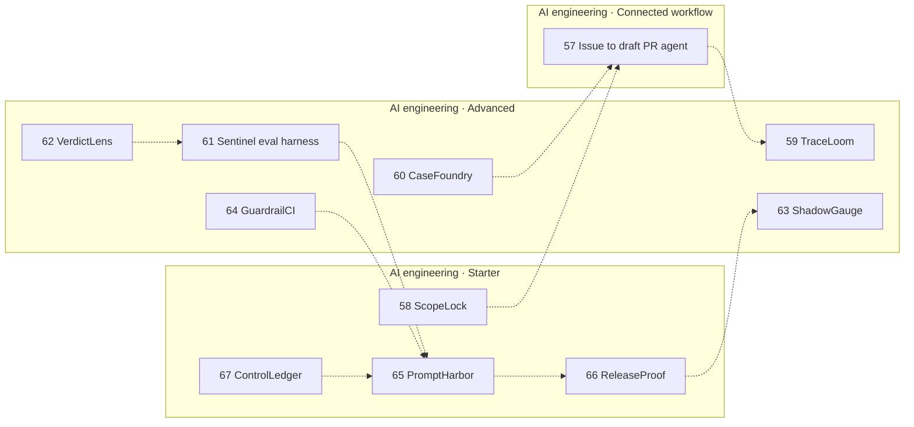
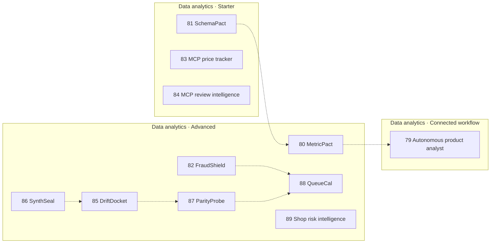
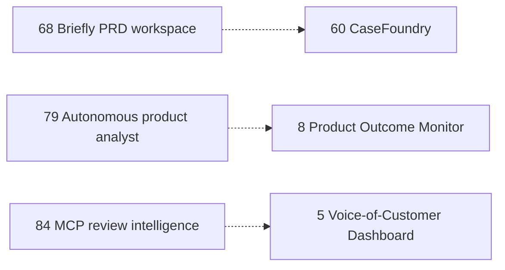

<div align="center">

# ProdMind

**A flagship collection for product evidence, AI engineering, and data analytics.** The connected product-management workspace remains the fifty-six-module Worker in Project 7.

[](https://github.com/MadanMohan0537/prodmind/actions/workflows/experiment-data-quality-auditor.yml)
[](https://developers.cloudflare.com/workers/)
[](LICENSE)

</div>

## Choose your entry point

| Goal | Entry point |
| --- | --- |
| Experience the composed workflow | [Project 7 workspace](experiment-data-quality-auditor/README.md) |
| Find a bounded product tool | The catalog below, grouped by track |
| Review what is connected | The implementation and security sections below |
| Contribute to one module | Its own README and source directory |

The root is a portfolio and integration map, not a single installable package. Follow the selected project's setup instead of assuming every module shares dependencies or a deployment target. The connected suite command below belongs to the Project 7 workspace.

When reviewing a recommendation, follow its evidence links and control status through the composed workflow. Passing a control demonstrates the encoded check; it does not replace a team's release or investment decision.

ProdMind connects customer evidence, product judgment, experimentation, outcome monitoring, and institutional learning in one traceable workflow. Each project solves one bounded problem; the Project 7 workspace composes their real implementations and preserves the same evidence identities from ingestion through retrieval.

No paid model or software service is required for the tested workflow. The connected application is designed for Cloudflare Workers and D1.

## Run one now

Project 1 runs on Node.js 22 with no install and no paid API:

```bash
node --test feedback_collector/test/feedback.test.js
```

The connected suite for Projects 1–56 is:

```bash
node experiment-data-quality-auditor/scripts/test-all.mjs
```

Every other folder has its own quick start in the catalog.

## Product lifecycle

```text
Customer feedback
      ↓
1. Normalize and validate
      ↓
2–4. Sentiment, topics and request intent
      ↓
5. Voice-of-Customer evidence
      ↓
6. Human-reviewed prioritization
      ↓
7. Experiment plan, audit and decision
      ↓
8. Post-decision outcome monitoring
      ↓
9. Searchable product learning memory
      ↓
10. Decision-confidence calibration
      ↺
11. Evidence-integrity monitoring
      ↓
12. Capacity-aware research planning
      ↓
13. Strategic portfolio alignment
      ↓
14. Minimum-disruption portfolio rebalancing
      ├→ 15. Declared-scenario portfolio resilience testing
      └→ 40. Evidence-linked roadmap delivery scheduling
              ↓
         41. Monitor roadmap delivery against the approved baseline
              ↓
         42. Plan bounded recovery actions for failed delivery controls
              ↓
         43. Verify recovery execution and restored delivery controls
              ↺
         44. Calibrate future estimates from completed comparable work
              ↓
         45. Control adoption of calibrated estimate factors
              ↓
         46. Verify estimate effectiveness after delivery
              ↓
         47. Monitor calibration drift and recalibration readiness
              ↓
         48. Validate a versioned recalibration on later holdout evidence
              ↓
         49. Assure shadow and staged recalibration rollout evidence
              ↓
         50. Verify exact rollback restoration and stable recovery
              ↓
         51. Govern incident learning and bounded recalibration re-entry
              ↓
         52. Assure observed shadow and bounded recalibration re-entry
              ↓
         53. Gate sustained re-entry promotion with independent approval
              ↓
         54. Verify activation, full adoption and promoted outcomes
              ↓
         55. Complete exact recalibration-baseline handoff
              ↓
         56. Monitor ongoing baseline configuration drift
      ↓
16. Expected-versus-observed benefits realization
      ↓
17. Post-implementation investment assurance
      ↺
18. Explicit assumption validation
      ↓
19. Progressive release and rollback readiness
      ↓
20. Feature adoption journey measurement
      ↓
21. Govern retention, investment, consolidation or retirement
      ↓
22. Verify migration and sunset readiness
      ↓
23. Verify post-sunset outcomes and reversibility
      ↓
24. Package decision provenance and governance evidence
      ↓
25. Monitor digest continuity, obligations, reviews and retention
      ↓
26. Govern temporary exceptions without hiding failed controls
      ↓
27. Verify corrective-action effectiveness before exception exit
      ↓
28. Monitor post-exit control regression and recurrence
      ↓
29. Convert recurrence evidence into a capacity-feasible improvement portfolio
      ↓
30. Verify improvement delivery and later control outcomes
      ↓
31. Calibrate improvement planning from verified portfolio evidence
      ↓
32. Plan reversible policy experiments for observed calibration gaps
      ↓
33. Verify completed policy experiments before human adoption
      ↓
34. Control versioned, gradual and reversible policy change readiness
      ↓
35. Assure that the approved policy rollout was executed as declared
      ↓
36. Monitor sustained planning-policy effectiveness and drift
      ↓
37. Verify authorized policy reversion and stable recovery
      ↓
38. Capture incident learning and govern safe policy re-entry
      ↓
39. Assure bounded post-incident policy re-entry
```

## Portfolio impact model

ProdMind is designed around decisions rather than disconnected demos:

| Decision layer | Projects | Intended impact |
|---|---|---|
| Evidence readiness | 1–5, 11, 18 | Trustworthy customer signals and explicit assumptions |
| Portfolio judgment and execution control | 6, 12–15, 40–56 | Explicit trade-offs across product, research, strategy, resilience, delivery capacity, actual execution, recovery, estimation learning, adoption control, observed effectiveness, performance drift, controlled recalibration, rollout assurance, rollback recovery verification, governed re-entry, observed re-entry assurance, sustained promotion control, verified promotion outcomes, exact baseline handoff and ongoing configuration drift |
| Experiment and release governance | 7, 19 | Prospective plans, reviewed decisions, staged release and rollback readiness |
| Learning, value and lifecycle | 8–10, 16–17, 20–23 | Monitored outcomes, reusable context, realized benefits, adoption, lifecycle decisions, migration assurance and post-sunset closeout |
| Governance and accountability | 24–39 | Provenance, continuous review, controlled exceptions, verified remediation, policy controls, verified recovery, blameless learning, safe re-entry, and observed re-entry assurance |

The product should be evaluated by evidence-linked decisions, time saved with review quality preserved, prevented data-quality failures, accepted research plans, monitored outcome coverage, and strategy exceptions resolved. None of these measures should reward automatic shipping or unsupported causal claims.

<!-- catalog:tracks:start -->
## Tracks

Projects already in the repo are grouped by area and tier. The quick start is the command for that folder.

| Area | Built |
|---|---:|
| Product management | 67 |
| AI engineering | 11 |
| Data analytics | 11 |
| **Catalog total** | **89** |

Solid arrows in the maps are the connected product-management lifecycle already imported by Project 7. Dotted arrows are intended handoffs. Dotted arrows are not Worker imports, and a downstream project does not read the upstream project’s files.

### Product management

#### Starter

| # | Project | Input → output | Quick start | Track |
|---:|---|---|---|---|
| 1 | [Feedback Collector](feedback_collector/) | raw customer feedback → validated, normalized, deduplicated feedback | `cd feedback_collector && npm install && npm run check` | PM |
| 2 | [Sentiment Analyzer](sentiment_analyzer/) | feedback text → explainable sentiment, aspects, and review flags | `cd sentiment_analyzer && npm install && npm run check` | PM |
| 3 | [Topic Modeler](topic_modeler/) | feedback text → topic assignments, keywords, hierarchy, and drift | `cd topic_modeler && npm install && npm run check` | PM |
| 4 | [Feature Request Detector](feature_request_detector/) | feedback text → multi-label product intent and evidence sentences | `cd feature_request_detector && npm install && npm run check` | PM |
| 5 | [Voice-of-Customer Dashboard](voice_of_customer_dashboard/) | enriched feedback → trends, filters, segments, and source evidence | `cd voice_of_customer_dashboard && npm install && npm run check` | PM |
| 6 | [Prioritization Engine](prioritization_engine/) | opportunities, weights, and capacity → transparent scores and a capacity-aware portfolio | `cd prioritization_engine && npm install && npm run check` | PM |
| 77 | [RiskCouncil](launch_premortem_risk_register/) | a launch brief → a multi-perspective premortem risk register | `cd launch_premortem_risk_register && PYTHONPATH=. python -m unittest discover -s tests -v` | PM |

#### Advanced

| # | Project | Input → output | Quick start | Track |
|---:|---|---|---|---|
| 8 | [Product Outcome Monitor](product_outcome_monitor/) | a decision and later snapshots → persistence, reversal, and guardrail signals | `cd product_outcome_monitor && npm install && npm run check` | PM |
| 9 | [Product Learning Memory](product_learning_memory/) | saved run evidence → cross-run lexical retrieval of linked learning | `cd product_learning_memory && npm install && npm run check` | PM |
| 10 | [Product Decision Calibration Engine](decision_calibration_engine/) | resolved product forecasts → Brier scores and reliability bands | `cd decision_calibration_engine && npm install && npm run check` | PM |
| 11 | [Product Evidence Integrity Monitor](evidence_integrity_monitor/) | evidence records → freshness, coverage, concentration, and lineage findings | `cd evidence_integrity_monitor && npm install && npm run check` | PM |
| 12 | [Product Research Portfolio Optimizer](research_portfolio_optimizer/) | evidence gaps and capacity → a selected set of research actions | `cd research_portfolio_optimizer && npm install && npm run check` | PM |
| 13 | [Product Strategy Alignment Auditor](strategy_alignment_auditor/) | selected effort and declared objectives → an effort-allocation alignment audit | `cd strategy_alignment_auditor && npm install && npm run check` | PM |
| 14 | [Strategic Portfolio Rebalancing Simulator](portfolio_rebalancing_simulator/) | a portfolio and declared constraints → a minimum-disruption rebalancing scenario | `cd portfolio_rebalancing_simulator && npm install && npm run check` | PM |
| 15 | [Product Portfolio Resilience Stress Tester](portfolio_resilience_stress_tester/) | a portfolio and declared shocks → scenario stress results | `cd portfolio_resilience_stress_tester && npm install && npm run check` | PM |
| 16 | [Product Benefits Realization Tracker](benefits_realization_tracker/) | benefit targets and observations → an expected-versus-observed realization ledger | `cd benefits_realization_tracker && npm install && npm run check` | PM |
| 17 | [Product Investment Assurance Review](investment_assurance_review/) | post-implementation evidence → completeness findings and a named assurance decision | `cd investment_assurance_review && npm install && npm run check` | PM |
| 18 | [Product Assumption Risk Register](assumption_risk_register/) | declared assumptions and links → validation urgency with evidence links | `cd assumption_risk_register && npm install && npm run check` | PM |
| 19 | [Product Release Readiness & Rollback Controller](release_readiness_controller/) | a rollout plan and declared controls → progressive-exposure and rollback readiness | `cd release_readiness_controller && npm install && npm run check` | PM |
| 20 | [Feature Adoption Journey Analyzer](feature_adoption_analyzer/) | ordered product events → adoption, time-to-value, and privacy-suppressed segments | `cd feature_adoption_analyzer && npm install && npm run check` | PM |
| 21 | [Product Lifecycle & Deprecation Planner](product_lifecycle_planner/) | a lifecycle proposal → migration, notice, dependency, and approval checks | `cd product_lifecycle_planner && npm install && npm run check` | PM |
| 22 | [Customer Migration & Sunset Monitor](sunset_migration_monitor/) | migration snapshots → cohort, notice, exception, and zero-use reconciliation | `cd sunset_migration_monitor && npm install && npm run check` | PM |
| 23 | [Product Sunset Outcome & Reversibility Monitor](sunset_outcome_monitor/) | post-sunset evidence → harm, residual-use, savings, and reversibility review | `cd sunset_outcome_monitor && npm install && npm run check` | PM |
| 24 | [Product Decision Provenance & Governance Pack](decision_provenance_pack/) | decision artifacts → a SHA-256 provenance pack and certification checks | `cd decision_provenance_pack && npm install && npm run check` | PM |
| 25 | [Product Governance Obligation & Review Monitor](governance_obligation_monitor/) | pack digests and obligations → continuity, review, certification, and retention findings | `cd governance_obligation_monitor && npm install && npm run check` | PM |
| 26 | [Product Governance Exception & Waiver Register](governance_exception_register/) | a failed control and waiver terms → a time-bounded exception record | `cd governance_exception_register && npm install && npm run check` | PM |
| 27 | [Product Exception Exit & Corrective-Action Verifier](exception_exit_verifier/) | follow-up evidence → an exception-exit verification result | `cd exception_exit_verifier && npm install && npm run check` | PM |
| 28 | [Product Control Regression & Recurrence Monitor](control_recurrence_monitor/) | post-exit snapshots → recurrence and coverage findings | `cd control_recurrence_monitor && npm install && npm run check` | PM |
| 29 | [Product Control Improvement Portfolio Planner](control_improvement_planner/) | recurrence targets and capacity → a selected improvement portfolio | `cd control_improvement_planner && npm install && npm run check` | PM |
| 30 | [Product Control Improvement Outcome Monitor](control_improvement_outcome_monitor/) | delivery and later surveillance → an improvement-outcome verification | `cd control_improvement_outcome_monitor && npm install && npm run check` | PM |
| 31 | [Product Control Improvement Calibration & Learning Engine](control_improvement_calibration/) | verified improvements → a planning calibration report | `cd control_improvement_calibration && npm install && npm run check` | PM |
| 32 | [Product Planning Policy Experiment Planner](planning_policy_experiment_planner/) | calibration gaps → a reversible policy-experiment plan | `cd planning_policy_experiment_planner && npm install && npm run check` | PM |
| 33 | [Product Planning Policy Experiment Outcome Verifier](planning_policy_outcome_verifier/) | trial observations → predeclared-measure verification | `cd planning_policy_outcome_verifier && npm install && npm run check` | PM |
| 34 | [Product Planning Policy Change & Version Controller](planning_policy_change_controller/) | an adoption decision → a versioned policy-change readiness result | `cd planning_policy_change_controller && npm install && npm run check` | PM |
| 35 | [Product Planning Policy Rollout Assurance Monitor](planning_policy_rollout_monitor/) | rollout observations → stage, dwell, and evidence assurance | `cd planning_policy_rollout_monitor && npm install && npm run check` | PM |
| 36 | [Product Planning Policy Effectiveness & Drift Monitor](planning_policy_effectiveness_monitor/) | longitudinal observations → effectiveness and drift findings | `cd planning_policy_effectiveness_monitor && npm install && npm run check` | PM |
| 37 | [Product Planning Policy Reversion & Recovery Verifier](planning_policy_recovery_verifier/) | reversion evidence → recovery verification | `cd planning_policy_recovery_verifier && npm install && npm run check` | PM |
| 38 | [Product Planning Policy Incident Learning & Re-entry Controller](planning_policy_incident_learning_controller/) | an incident record → a learning review and re-entry gate | `cd planning_policy_incident_learning_controller && npm install && npm run check` | PM |
| 39 | [Product Planning Policy Re-entry Assurance Monitor](planning_policy_reentry_monitor/) | re-entry observations → bounded re-entry assurance | `cd planning_policy_reentry_monitor && npm install && npm run check` | PM |
| 40 | [Evidence-linked Product Roadmap Delivery Scheduler](roadmap_delivery_scheduler/) | selected items, capacity, and dependencies → a bounded delivery schedule | `cd roadmap_delivery_scheduler && npm install && npm run check` | PM |
| 41 | [Roadmap Delivery Execution & Variance Monitor](roadmap_delivery_monitor/) | a baseline and actuals → variance, capacity, and blocker controls | `cd roadmap_delivery_monitor && npm install && npm run check` | PM |
| 42 | [Roadmap Delivery Recovery Action Planner](roadmap_recovery_planner/) | failed delivery controls → selected recovery actions | `cd roadmap_recovery_planner && npm install && npm run check` | PM |
| 43 | [Roadmap Recovery Execution & Effectiveness Verifier](roadmap_recovery_verifier/) | execution evidence → restoration verification | `cd roadmap_recovery_verifier && npm install && npm run check` | PM |
| 44 | [Roadmap Delivery Estimate Calibration & Reference-Class Engine](roadmap_estimate_calibration/) | completed comparable work → reviewed estimate factors | `cd roadmap_estimate_calibration && npm install && npm run check` | PM |
| 45 | [Roadmap Estimate Basis & Calibration Adoption Controller](roadmap_estimate_adoption_controller/) | factors and item bases → an estimate-adoption control result | `cd roadmap_estimate_adoption_controller && npm install && npm run check` | PM |
| 46 | [Roadmap Estimate Calibration Effectiveness & Exception Outcome Monitor](roadmap_estimate_effectiveness_monitor/) | completed outcomes → an error-reduction review | `cd roadmap_estimate_effectiveness_monitor && npm install && npm run check` | PM |
| 47 | [Roadmap Estimate Calibration Drift & Recalibration Readiness Monitor](roadmap_estimate_drift_monitor/) | chronological assessment windows → drift findings and recalibration candidates | `cd roadmap_estimate_drift_monitor && npm install && npm run check` | PM |
| 48 | [Roadmap Estimate Recalibration Proposal & Validation Controller](roadmap_recalibration_controller/) | training rows and a later holdout → a versioned recalibration proposal | `cd roadmap_recalibration_controller && npm install && npm run check` | PM |
| 49 | [Roadmap Estimate Recalibration Rollout Assurance Monitor](roadmap_recalibration_rollout_monitor/) | staged exposure evidence → recalibration rollout assurance | `cd roadmap_recalibration_rollout_monitor && npm install && npm run check` | PM |
| 50 | [Roadmap Recalibration Rollback & Recovery Verifier](roadmap_recalibration_recovery_verifier/) | rollback evidence → exact restoration verification | `cd roadmap_recalibration_recovery_verifier && npm install && npm run check` | PM |
| 51 | [Roadmap Recalibration Incident Learning & Re-entry Controller](roadmap_recalibration_incident_reentry_controller/) | incident learning → a recalibration re-entry control | `cd roadmap_recalibration_incident_reentry_controller && npm install && npm run check` | PM |
| 52 | [Roadmap Recalibration Re-entry Assurance Monitor](roadmap_recalibration_reentry_monitor/) | observed re-entry stages → re-entry assurance | `cd roadmap_recalibration_reentry_monitor && npm install && npm run check` | PM |
| 53 | [Roadmap Recalibration Re-entry Promotion Controller](roadmap_recalibration_reentry_promotion_controller/) | sustained checkpoints → a promotion gate | `cd roadmap_recalibration_reentry_promotion_controller && npm install && npm run check` | PM |
| 54 | [Roadmap Recalibration Promotion Outcome Monitor](roadmap_recalibration_promotion_outcome_monitor/) | activation evidence → a promotion outcome review | `cd roadmap_recalibration_promotion_outcome_monitor && npm install && npm run check` | PM |
| 55 | [Roadmap Recalibration Baseline Handoff Controller](roadmap_recalibration_baseline_handoff_controller/) | a retained baseline → a baseline handoff control | `cd roadmap_recalibration_baseline_handoff_controller && npm install && npm run check` | PM |
| 56 | [Roadmap Recalibration Baseline Configuration Drift Monitor](roadmap_recalibration_baseline_drift_monitor/) | configuration snapshots → baseline drift findings | `cd roadmap_recalibration_baseline_drift_monitor && npm install && npm run check` | PM |
| 68 | [Briefly PRD workspace](briefly_prd_ai/) | a rough product concept → an editable PRD draft | `cd briefly_prd_ai && pnpm install && pnpm test` | PM |
| 69 | [AI project manager assistant](ai_project_manager_assistant/) | a project description and a team → a work breakdown, assignments, and a RAID register | `cd ai_project_manager_assistant && npm install && npm run check` | PM |
| 71 | [Experimentation copilot](ab_test_design_and_readout/) | a hypothesis and observed results → a sample-size plan and a validity-first readout | `cd ab_test_design_and_readout && python -m pip install -r requirements.txt && PYTHONPATH=. python -m unittest discover -s tests -v` | PM |
| 72 | [AB Advisor](bayesian_ab_test_advisor/) | variant assignments and metric outcomes → posterior lift and expected loss | `cd bayesian_ab_test_advisor && python -m pip install numpy scipy pytest && PYTHONPATH=. python -m pytest -q` | PM |
| 73 | [Signal stakeholder sentiment](ai_stakeholder_sentiment_analyzer/) | stakeholder comments → topic, sentiment, and urgency with source quotes | `cd ai_stakeholder_sentiment_analyzer && python -m pip install -r requirements.txt && PYTHONPATH=. python -m pytest -q` | PM |
| 74 | [AI product discovery engine](ai_product_discovery_engine/) | customer feedback text → ranked opportunities with evidence links | `cd ai_product_discovery_engine && node --test tests/*.test.js` | PM |
| 76 | [AI roadmap optimizer](ai_roadmap_optimizer/) | a feature backlog and capacity → feasible, strategy-aware delivery scenarios | `cd ai_roadmap_optimizer && node --test` | PM |
| 78 | [SecondChance Lab](user_journey_recovery_testing/) | a critical user-journey contract → interruption results and side-effect checks | `cd user_journey_recovery_testing && npm install && npm test` | PM |

#### Connected workflow

| # | Project | Input → output | Quick start | Track |
|---:|---|---|---|---|
| 7 | [Experiment & Learning Workspace](experiment-data-quality-auditor/) | portfolio selection and event snapshots → an audited experiment plan and a human decision | `cd experiment-data-quality-auditor && npm install && npm run check` | PM |
| 70 | [Experiment decision workspace](experiment_decision_workspace/) | a hypothesis, results, and guardrails → a ship, hold, iterate, or rollback record | `cd experiment_decision_workspace && npm install && npm test` | PM |
| 75 | [Pulse feedback prioritizer](feedback_prioritizer/) | feedback from disconnected channels → normalized evidence and a transparent priority list | `cd feedback_prioritizer && python -m pip install scikit-learn pandas numpy && PYTHONPATH=. python -m unittest discover -s tests -v` | PM |

```mermaid
flowchart LR
  subgraph product_management_starter [Product management · Starter]
    n1["1 Feedback Collector"]
    n2["2 Sentiment Analyzer"]
    n3["3 Topic Modeler"]
    n4["4 Feature Request Detector"]
    n5["5 Voice-of-Customer Dashboard"]
    n6["6 Prioritization Engine"]
    n77["77 RiskCouncil"]
  end
  subgraph product_management_advanced [Product management · Advanced]
    n8["8 Product Outcome Monitor"]
    n9["9 Product Learning Memory"]
    n10["10 Product Decision Calibration Engine"]
    n11["11 Product Evidence Integrity Monitor"]
    n12["12 Product Research Portfolio Optimizer"]
    n13["13 Product Strategy Alignment Auditor"]
    n14["14 Strategic Portfolio Rebalancing Simulator"]
    n15["15 Product Portfolio Resilience Stress Tester"]
    n16["16 Product Benefits Realization Tracker"]
    n17["17 Product Investment Assurance Review"]
    n18["18 Product Assumption Risk Register"]
    n19["19 Product Release Readiness and Rollback Controller"]
    n20["20 Feature Adoption Journey Analyzer"]
    n21["21 Product Lifecycle and Deprecation Planner"]
    n22["22 Customer Migration and Sunset Monitor"]
    n23["23 Product Sunset Outcome and Reversibility Monitor"]
    n24["24 Product Decision Provenance and Governance Pack"]
    n25["25 Product Governance Obligation and Review Monitor"]
    n26["26 Product Governance Exception and Waiver Register"]
    n27["27 Product Exception Exit and Corrective-Action Verifier"]
    n28["28 Product Control Regression and Recurrence Monitor"]
    n29["29 Product Control Improvement Portfolio Planner"]
    n30["30 Product Control Improvement Outcome Monitor"]
    n31["31 Product Control Improvement Calibration and Learning Engine"]
    n32["32 Product Planning Policy Experiment Planner"]
    n33["33 Product Planning Policy Experiment Outcome Verifier"]
    n34["34 Product Planning Policy Change and Version Controller"]
    n35["35 Product Planning Policy Rollout Assurance Monitor"]
    n36["36 Product Planning Policy Effectiveness and Drift Monitor"]
    n37["37 Product Planning Policy Reversion and Recovery Verifier"]
    n38["38 Product Planning Policy Incident Learning and Re-entry Controller"]
    n39["39 Product Planning Policy Re-entry Assurance Monitor"]
    n40["40 Evidence-linked Product Roadmap Delivery Scheduler"]
    n41["41 Roadmap Delivery Execution and Variance Monitor"]
    n42["42 Roadmap Delivery Recovery Action Planner"]
    n43["43 Roadmap Recovery Execution and Effectiveness Verifier"]
    n44["44 Roadmap Delivery Estimate Calibration and Reference-Class Engine"]
    n45["45 Roadmap Estimate Basis and Calibration Adoption Controller"]
    n46["46 Roadmap Estimate Calibration Effectiveness and Exception Outcome Monitor"]
    n47["47 Roadmap Estimate Calibration Drift and Recalibration Readiness Monitor"]
    n48["48 Roadmap Estimate Recalibration Proposal and Validation Controller"]
    n49["49 Roadmap Estimate Recalibration Rollout Assurance Monitor"]
    n50["50 Roadmap Recalibration Rollback and Recovery Verifier"]
    n51["51 Roadmap Recalibration Incident Learning and Re-entry Controller"]
    n52["52 Roadmap Recalibration Re-entry Assurance Monitor"]
    n53["53 Roadmap Recalibration Re-entry Promotion Controller"]
    n54["54 Roadmap Recalibration Promotion Outcome Monitor"]
    n55["55 Roadmap Recalibration Baseline Handoff Controller"]
    n56["56 Roadmap Recalibration Baseline Configuration Drift Monitor"]
    n68["68 Briefly PRD workspace"]
    n69["69 AI project manager assistant"]
    n71["71 Experimentation copilot"]
    n72["72 AB Advisor"]
    n73["73 Signal stakeholder sentiment"]
    n74["74 AI product discovery engine"]
    n76["76 AI roadmap optimizer"]
    n78["78 SecondChance Lab"]
  end
  subgraph product_management_connected [Product management · Connected workflow]
    n7["7 Experiment and Learning Workspace"]
    n70["70 Experiment decision workspace"]
    n75["75 Pulse feedback prioritizer"]
  end
  n1 --> n2
  n1 --> n3
  n1 --> n4
  n2 --> n5
  n3 --> n5
  n4 --> n5
  n5 --> n6
  n6 --> n7
  n7 --> n8
  n8 --> n9
  n9 --> n10
  n10 --> n11
  n11 --> n12
  n12 --> n13
  n13 --> n14
  n14 --> n15
  n14 --> n16
  n14 --> n40
  n16 --> n17
  n17 --> n18
  n18 --> n19
  n19 --> n20
  n20 --> n21
  n21 --> n22
  n22 --> n23
  n23 --> n24
  n24 --> n25
  n25 --> n26
  n26 --> n27
  n27 --> n28
  n28 --> n29
  n29 --> n30
  n30 --> n31
  n31 --> n32
  n32 --> n33
  n33 --> n34
  n34 --> n35
  n35 --> n36
  n36 --> n37
  n37 --> n38
  n38 --> n39
  n40 --> n41
  n41 --> n42
  n42 --> n43
  n43 --> n44
  n44 --> n45
  n45 --> n46
  n46 --> n47
  n47 --> n48
  n48 --> n49
  n49 --> n50
  n50 --> n51
  n51 --> n52
  n52 --> n53
  n53 --> n54
  n54 --> n55
  n55 --> n56
  n68 -.-> n77
  n68 -.-> n69
  n69 -.-> n76
  n70 -.-> n7
  n71 -.-> n70
  n72 -.-> n70
  n73 -.-> n2
  n74 -.-> n6
  n75 -.-> n6
  n76 -.-> n40
  n77 -.-> n18
  n78 -.-> n19
```



### AI engineering

#### Starter

| # | Project | Input → output | Quick start | Track |
|---:|---|---|---|---|
| 58 | [ScopeLock](scopelock/) | an agent tool call and a policy → an allow or deny decision with an audit record | `cd scopelock && PYTHONPATH=. python -m unittest discover -s tests -v` | AI Engineer |
| 65 | [PromptHarbor](prompt_release_management/) | a prompt bundle change and eval evidence → a versioned release with canary and rollback records | `cd prompt_release_management && PYTHONPATH=. python -m unittest discover -s tests -v` | AI Engineer |
| 66 | [ReleaseProof](releaseproof/) | baseline and candidate evaluation runs → a PASS or BLOCK decision with case-level evidence | `cd releaseproof && PYTHONPATH=. python -m unittest discover -s tests -v` | AI Engineer |
| 67 | [ControlLedger](ai_use_case_risk_registry/) | structured AI system intake → a tiered control checklist and evidence inventory | `cd ai_use_case_risk_registry && PYTHONPATH=. python -m unittest discover -s tests -v` | AI Engineer |

#### Advanced

| # | Project | Input → output | Quick start | Track |
|---:|---|---|---|---|
| 59 | [TraceLoom](agent_trace_debugger/) | multi-step agent spans → a replayable timeline, failure class, and cost per successful task | `cd agent_trace_debugger && PYTHONPATH=. python -m unittest discover -s tests -v` | AI Engineer |
| 60 | [CaseFoundry](requirements_traced_test_generator/) | numbered PRD clauses → traceable cases and a mutation-detection report | `cd requirements_traced_test_generator && PYTHONPATH=. python -m unittest discover -s tests -v` | AI Engineer |
| 61 | [Sentinel eval harness](sentinel_eval_harness/) | a versioned evaluation set → a pass-rate gate with cost evidence | `cd sentinel_eval_harness && python -m pip install pytest && PYTHONPATH=. python -m pytest -q` | AI Engineer |
| 62 | [VerdictLens](llm_judge_calibration_workbench/) | pairwise judge votes and reference labels → agreement, kappa, and order or length bias probes | `cd llm_judge_calibration_workbench && PYTHONPATH=. python -m unittest discover -s tests -v` | AI Engineer |
| 63 | [ShadowGauge](shadow_eval_drift_monitor/) | sampled AI interactions → off-path grades and a two-window drift incident | `cd shadow_eval_drift_monitor && PYTHONPATH=. python -m unittest discover -s tests -v` | AI Engineer |
| 64 | [GuardrailCI](ai_red_team_regression_suite/) | a versioned multi-step attack library → rubric scores and a release regression report | `cd ai_red_team_regression_suite && PYTHONPATH=. python -m unittest discover -s tests -v` | AI Engineer |

#### Connected workflow

| # | Project | Input → output | Quick start | Track |
|---:|---|---|---|---|
| 57 | [Issue to draft PR agent](issue_to_draft_pr_agent/) | a GitHub issue and a local repository → a tested draft-PR record with execution evidence | `cd issue_to_draft_pr_agent && python -m pip install -e '.[dev]' && PYTHONPATH=. python -m pytest -q` | AI Engineer |



### Data analytics

#### Starter

| # | Project | Input → output | Quick start | Track |
|---:|---|---|---|---|
| 81 | [SchemaPact](data_contract_impact_checker/) | a versioned data contract and a batch or schema change → a pass, warn, or block decision and consumer impact | `cd data_contract_impact_checker && PYTHONPATH=. python -m unittest discover -s tests -v` | Data analytics |
| 83 | [MCP price tracker](mcp_price_tracker/) | public price and availability observations → price history and threshold checks | `cd mcp_price_tracker && PYTHONPATH=. python -m unittest discover -s tests -v` | Data analytics |
| 84 | [MCP review intelligence](mcp_review_intelligence/) | a review export → deduplicated themes and sentiment with source rows | `cd mcp_review_intelligence && PYTHONPATH=. python -m unittest discover -s tests -v` | Data analytics |

#### Advanced

| # | Project | Input → output | Quick start | Track |
|---:|---|---|---|---|
| 80 | [MetricPact](governed_metric_query_engine/) | a business question and an allow-listed metric layer → a metric answer inside the scan budget | `cd governed_metric_query_engine && PYTHONPATH=. python -m unittest discover -s tests -v` | Data analytics |
| 82 | [FraudShield](explainable_order_risk_scoring/) | order features → an explainable risk score | `cd explainable_order_risk_scoring && node --check worker/index.js` | Data analytics |
| 85 | [DriftDocket](model_drift_retraining_decisions/) | feature and mature-label snapshots → drift findings and an evidence-backed retraining ticket | `cd model_drift_retraining_decisions && PYTHONPATH=. python -m unittest discover -s tests -v` | Data analytics |
| 86 | [SynthSeal](synthetic_data_release_audit/) | a synthetic table and a real holdout → fidelity, utility, privacy, and a data card | `cd synthetic_data_release_audit && PYTHONPATH=. python -m unittest discover -s tests -v` | Data analytics |
| 87 | [ParityProbe](counterfactual_fairness_audit/) | scored records and attribute-swap pairs → flip rates with uncertainty and a mitigation comparison | `cd counterfactual_fairness_audit && PYTHONPATH=. python -m unittest discover -s tests -v` | Data analytics |
| 88 | [QueueCal](confidence_routing_review_queue/) | confidence scores, error cost, and reviewer capacity → a threshold and an SLA queue plan | `cd confidence_routing_review_queue && PYTHONPATH=. python -m unittest discover -s tests -v` | Data analytics |
| 89 | [Shop risk intelligence](marketplace_risk_intelligence/) | synthetic marketplace orders and rules → a risk investigation report | `cd marketplace_risk_intelligence && python -m pip install -r requirements.txt && PYTHONPATH=. python -m pytest -q` | Data analytics |

#### Connected workflow

| # | Project | Input → output | Quick start | Track |
|---:|---|---|---|---|
| 79 | [Autonomous product analyst](autonomous_product_analyst/) | a question about a governed metric → a segment investigation with the queries that support it | `cd autonomous_product_analyst && python -m pip install -r requirements.txt && PYTHONPATH=. python -m unittest discover -s tests -v` | Data analytics |



### Cross-area handoffs


<!-- catalog:tracks:end -->

## What is genuinely connected

Project 7 imports and executes Projects 1–6 and the engines behind Projects 8–56. Folders numbered 57 and above are standalone imports. They are not loaded by the Project 7 Worker. Dotted catalog arrows are intended handoffs: the downstream folder does not read the upstream folder’s files. The connected path spans customer evidence, portfolio selection, executable roadmap scheduling, actual delivery control, bounded recovery planning, recovery effectiveness verification, estimate calibration, adoption control, completed-outcome effectiveness review, performance-drift monitoring, holdout-tested recalibration proposals, controlled rollout assurance, verified rollback recovery, governed incident learning, observed re-entry assurance, sustained promotion control, verified promotion outcomes, exact baseline handoff and ongoing configuration-drift monitoring, decisions, lifecycle governance, verified policy recovery, incident learning, controlled re-entry, and re-entry assurance.

Identity lineage:

```text
feedbackId → topicId → runId:opportunityId → experimentId
           ↘ portfolioItemId → roadmapScheduleId → dated team work
                                → deliveryMonitorId → snapshots / variance / blockers
                                  → recoveryPlanId → failed controls / selected actions / review
                                    → recoveryVerificationId → action outcomes / restored controls / closeout review
                                      → roadmapCalibrationId → reference classes / error / reviewed factors
                                        → estimateAdoptionControlId → bases / factors / exceptions / approval
                                          → estimateEffectivenessId → actuals / error reductions / exception outcomes / review
                                            → estimateDriftId → baseline / recent windows / class signals / recalibration candidates
                                              → recalibrationId → training / holdout / candidate factors / versions / rollback / approvals
                                                → recalibrationRolloutId → shadow / staged exposure / paired errors / incidents / tested rollback
                                                  → recalibrationRecoveryId → execution / exact factors / stable observations / closeout review
                                                    → recalibrationReentryId → timeline / actions / cooling / new candidate / approvals
                                                      → recalibrationReentryAssuranceId → declaration / stages / controls / recurrence / rollback
                                                        → recalibrationReentryPromotionId → stabilization / paired outcomes / controls / approvals
                                                          → recalibrationPromotionOutcomeId → activation / adoption / operating outcomes / retention
                                                            → recalibrationBaselineHandoffId → manifest / consumers / archive / monitoring / completion
                                                              → recalibrationBaselineDriftId → snapshots / convergence / obligations / human action
           → auditId → decisionId → monitorId
           → benefitId
           → assuranceReviewId → actionId
           ↺ assumptionId → evidenceId / experimentId
           → releaseId → monitor / rollback trigger
           → journeyId → ordered stage observations
           → lifecyclePlanId → dependencies / notices / approvals
           → migrationSnapshotId → cohorts / receipts / exceptions
           → outcomeReviewId → harm / incidents / savings / rollback / actions
           → governancePackId → canonical artifacts / SHA-256 chain / approvals
           → governanceMonitorId → obligations / review windows / retention action
           → exceptionRegisterId → scope / controls / remediation / approvals / expiry
           → exceptionExitReviewId → follow-up monitor / effectiveness tests / closure approval
           → recurrenceSurveillanceId → later snapshots / stability / cadence / human action
           → improvementActionId → recurrence target / owner / capacity / verification window
           → improvementOutcomeReviewId → delivery / effort / later surveillance / human closeout
           → calibrationReport → effort / delivery / effectiveness / recurrence learning
           → policyExperimentId → gap / hypothesis / guardrail / rollback / human approval
           → policyOutcomeReviewId → observations / prerequisite checks / human adoption decision
           → policyChangeId → active version / scope / rollout / monitors / rollback / approvals
           → policyRolloutId → stages / dwell / version / monitors / evidence / human decision
           → policyEffectivenessReviewId → longitudinal outcomes / drift / human decision
           → policyRecoveryReviewId → execution / target version / recovery / human closure
           → policyIncidentLearningReviewId → causes / lessons / actions / re-entry decision
           → policyReentryAssuranceId → declaration / stages / controls / signals / guardrails / human decision
```

Every opportunity and experiment retains `evidenceIds`. Within a run, `opportunityId` is stable; cross-run portfolio work uses `portfolioItemId` (`runId:opportunityId`) so same-named opportunities never collide. Client-provided IDs cannot replace server-owned links during prioritization or outcome monitoring.

## Primary frontend

The deployable interface in `experiment-data-quality-auditor/public/` supports:

1. Loading and creating D1-backed discovery runs.
2. Uploading normalized feedback JSON.
3. Inspecting Projects 2–5 evidence.
4. Entering explicit opportunity assessments.
5. Saving Project 6 rankings and portfolio selections.
6. Creating and locking experiment plans.
7. Auditing event snapshots and recording reviewed decisions.
8. Uploading Project 8 monitoring snapshots.
9. Searching Project 9 learning across saved runs.
10. Reviewing Project 10 portfolio calibration against resolved outcomes.
11. Reviewing Project 11 integrity findings against original evidence IDs.
12. Optimizing Project 12 research actions within available capacity.
13. Auditing Project 13 selected effort against declared strategic objectives.
14. Simulating Project 14’s smallest feasible portfolio change without overwriting the saved ranking.
15. Stress-testing Project 15 portfolios against declared capacity, dependency and effort scenarios.
16. Comparing Project 16 benefit targets with observed measures and original decision evidence.
17. Recording Project 17 post-implementation assurance decisions and accountable corrective actions.
18. Registering Project 18 assumptions and ordering evidence-linked validation work.
19. Verifying Project 19 progressive rollout, monitoring and rollback readiness.
20. Measuring Project 20 ordered adoption, time-to-value, and privacy-suppressed segments.
21. Validating Project 21 retain, invest, consolidate, and retire safeguards.
22. Reconciling Project 22 migration cohorts, notices, dependencies, zero-use evidence, and final approvals.
23. Reviewing Project 23 post-sunset outcomes, residual traffic, realized savings, reversibility, corrective actions, and the named human closeout decision.
24. Packaging Project 24 authoritative artifacts, digest lineage, approval separation, retention metadata, and named certification.
25. Monitoring Project 25 digest continuity, owned obligations, review and certification windows, and retention decisions.
26. Governing Project 26 temporary exceptions without overwriting the failed Project 25 result.
27. Verifying Project 27 target resolution and corrective-action effectiveness before exception exit.
28. Monitoring Project 28 follow-up snapshots for post-exit control recurrence.
29. Planning Project 29 evidence-linked control improvements within declared capacity.
30. Verifying Project 30 improvement delivery and later recurrence outcomes before human closeout.
31. Calibrating Project 31 planning evidence across verified improvements without rewriting estimates or scoring people.
32. Planning Project 32 reversible policy experiments for failed calibration checks without changing operating policy automatically.
33. Verifying Project 33 completed trials against their predeclared measures before a human adopts, extends, or rolls back policy.
34. Controlling Project 34 versioned, scoped, gradual, monitored, reversible policy-change readiness without activating policy.
35. Verifying Project 35 rollout stages, dwell periods, target version, declared monitors, evidence, and named human decision without changing policy state.
36. Monitoring Project 36 sustained primary outcomes, guardrails, cadence, version, sample sufficiency, evidence, and drift without changing policy or claiming causality.
37. Verifying Project 37 authorized reversion, complete execution, approved target version, recovery cadence, monitor stability, and evidence without changing policy or closing the event.
38. Governing Project 38 blameless learning, corrective actions, cooling time, recovered baseline, safety controls, and independent re-entry approval without lifting a freeze or starting a trial.
39. Assuring Project 39 predeclared, bounded re-entry stages, critical corrective controls, recurrence signals, guardrails, and a named human decision without changing policy or trial state.
40. Scheduling Project 40 selected portfolio items across declared dependencies, team capacity, calendars, and deadlines without changing the portfolio, assigning people, or committing delivery.
41. Monitoring Project 41 actual delivery against the approved baseline without changing schedules, assignments, estimates, progress, or blockers.
42. Planning Project 42 evidence-linked recovery actions for failed delivery controls without changing the baseline, scope, deadlines, staffing, blockers, or work state.
43. Verifying Project 43 recovery execution and later restoration of originally failed delivery controls without executing work, changing the baseline, or closing recovery automatically.
44. Calibrating Project 44 future estimating context from completed comparable work without rewriting estimates, evaluating people, or claiming delivery certainty.
45. Controlling Project 45 use of prior calibration through per-item arithmetic, evidence, freshness, and independent exceptions without creating or changing an estimate.
46. Verifying Project 46 estimate accuracy, error reduction, and exception outcomes against reviewed completed evidence without changing factors, estimates, schedules, or product state.
47. Monitoring Project 47 longitudinal estimate accuracy, retained improvement, class coverage, cadence, and recalibration readiness without changing factors, estimates, schedules, or product state.
48. Validating Project 48 training-only candidate factors against later holdout evidence with version, rollback, and independent-approval controls without activating factors or changing estimates, schedules, assignments, or product state.
49. Assuring Project 49 shadow and staged recalibration rollout evidence against the exact approved version and factors without changing exposure, activating factors, editing estimates, promoting a version, executing rollback, or changing product state.
50. Verifying Project 50 an authorized recalibration rollback restored the exact prior version and factors and remained stable without executing rollback, changing versions or factors, editing estimates, changing exposure, or closing recovery automatically.
51. Governing Project 51 blameless recalibration incident learning, corrective actions, cooling, a new candidate, shadow-first exposure, rollback, monitoring, and independent approval without lifting a freeze, starting rollout, changing factors or estimates, or approving its own re-entry.
52. Assuring Project 52 observed recalibration re-entry against the exact Project 51 plan, paired outcomes, corrective controls, recurrence signals, incidents, and rollback without changing exposure, activating or promoting a version, editing estimates, pausing or rolling back a trial, or approving continuation automatically.
53. Governing Project 53 sustained re-entry promotion through checkpoint continuity, paired class outcomes, control health, recurrence, incidents, current rollback, and independent approvals without activating or promoting a version, changing factors or estimates, extending exposure, removing rollback, or executing a decision automatically.
54. Verifying Project 54 the human-executed promotion used the exact authorized versions and scope, reached declared adoption, remained accurate and controlled, and retained current rollback without activating or reverting a version, editing estimates or factors, changing exposure, or retaining the baseline automatically.
55. Controlling Project 55 the handoff of that retained baseline through an exact manifest, class registration, consumer convergence, immutable archive, current rollback, future monitoring, independent approvals, and a named decision without changing configuration, factors, estimates, schedules, consumers, archives, monitoring, rollback, or product state.
56. Monitoring Project 56 chronological configuration snapshots for version, manifest, class, and consumer drift while verifying archive, rollback, and monitoring obligations without self-healing or changing configuration, factors, estimates, schedules, consumers, archives, rollback, monitoring, or product state.

All project frontends use system-aware light and dark color schemes. Standalone interfaces are useful for focused demonstrations; Project 7 is the integrated product.

## Run the complete test suite

Node.js 22.13 or later is recommended.

```bash
git clone https://github.com/MadanMohan0537/prodmind.git
cd prodmind
node experiment-data-quality-auditor/scripts/test-all.mjs
```

The suite covers all fifty-six projects, shared contracts, authenticated routes, SQLite migrations, evidence lineage, deterministic roadmap scheduling, delivery control, recovery planning and verification, estimate calibration, adoption control, effectiveness review, performance- and configuration-drift monitoring, recalibration validation, rollout assurance, rollback recovery verification, governed re-entry, observed re-entry assurance, sustained promotion control, verified promotion outcomes and exact baseline handoff, decision gates, lifecycle safeguards, verified policy recovery, incident learning, safe re-entry, and re-entry assurance.

That command covers Projects 1–56 only. Folders 57 and above keep the test command in their catalog quick start. Catalog links are checked separately:

```bash
node scripts/check-catalog.mjs
```

Run one project independently:

```bash
cd feedback_collector
npm install
npm run check
```

## Deploy the connected product

```bash
cd experiment-data-quality-auditor
npx wrangler d1 create prodmind-workflow
# copy the returned database ID into wrangler.jsonc
npx wrangler d1 migrations apply prodmind-workflow --remote
npx wrangler secret put API_TOKEN
npx wrangler deploy
```

Projects 1–6 and 8–56 are bundled into the connected Worker through imports. Their standalone deployments remain independent and are not silently synchronized.

## Security and decision boundaries

- Connected API access fails closed without D1 and `API_TOKEN`.
- Mutations require the latest workflow version.
- Cross-origin API requests are rejected.
- Raw experiment user IDs are excluded from persisted audit reports.
- Feedback content and customer identifiers may be sensitive; use pseudonymous data.
- Classifier confidence is not business value.
- Counts and rate differences are not statistical or causal proof.
- Outcome signals do not automatically approve rollout changes.
- Historical search results do not automatically change priorities.
- Calibration results describe a portfolio and do not evaluate individual employees.
- Evidence-integrity scores are review heuristics, not representativeness guarantees.
- Research optimization covers declared findings; it does not prove that a study will resolve them.
- Strategy allocation describes selected effort; it does not measure realized benefits.
- Rebalancing produces a reviewable scenario; it never applies ranking or roadmap changes.
- Roadmap scheduling uses declared estimates, calendars, and capacity; it never changes selection, assigns people, predicts delivery, or treats dependency-only float as resource-aware risk.
- Roadmap delivery monitoring compares declared baseline and actual evidence; it never updates work or blockers, evaluates people, predicts delivery probability, or claims certified EVM.
- Roadmap recovery planning selects declared corrective actions; it never changes baselines, scope, deadlines, staffing, blockers, or delivery state and does not claim root cause.
- Roadmap recovery verification checks supplied execution and later control evidence; it never executes actions, changes work or baselines, closes recovery automatically, establishes root cause or causality, predicts delivery, or certifies EVMS compliance.
- Roadmap estimate calibration summarizes completed comparable cases; it never rewrites plans, predicts delivery, evaluates people, treats historical association as causal, or applies a factor automatically.
- Roadmap estimate adoption control verifies declared factor use, arithmetic and exceptions; it never creates or changes an estimate, predicts delivery, evaluates people, or certifies accuracy.
- Roadmap estimate effectiveness and drift monitoring compare supplied completed outcomes and chronological assessment windows; neither changes factors or schedules, proves causality, or treats policy thresholds as statistical control limits.
- Roadmap recalibration control derives candidates only from earlier training observations and compares them on a later holdout; approval never activates a version, guarantees generalization, establishes statistical significance, or changes estimates, schedules, assignments, or product state.
- Roadmap recalibration rollout assurance compares exact approved factors with the concurrent active baseline through declared stages; it does not establish statistical significance, verify evidence truth, change exposure, activate factors, edit estimates, promote a version, or execute rollback.
- Roadmap recalibration recovery verification checks supplied rollback and stability evidence; it never executes rollback, changes versions or factors, edits estimates, changes exposure, or closes recovery automatically.
- Roadmap recalibration incident re-entry control checks blameless learning, corrective action, cooling, candidate, safety and approval evidence; it never lifts a freeze, starts rollout, assigns blame, changes factors or estimates, or approves its own re-entry.
- Roadmap recalibration re-entry assurance checks observed stages against the exact approved retry; it never changes exposure, activates or promotes a version, edits estimates, pauses or rolls back a trial, assigns blame, or proves causality.
- Roadmap recalibration re-entry promotion checks sustained observations, healthy controls, current rollback and independent approval; it never activates or promotes a version, changes factors or estimates, extends exposure, removes rollback, or proves causality.
- Roadmap recalibration promotion outcome monitoring checks exact activation, adoption, operating accuracy, controls, incidents and rollback; it never activates or reverts a version, changes estimates or factors, changes exposure, retains a baseline, or proves causality.
- Roadmap recalibration baseline handoff control checks one exact manifest, class registrations, required-consumer convergence, immutable archive, rollback, monitoring and independent approval; it never changes any configuration, factor, estimate, schedule, consumer, archive, rollback, monitor, or product state.
- Roadmap recalibration baseline configuration-drift monitoring checks chronological snapshots, manifest and class continuity, all required consumers, archive, rollback and monitoring obligations; it never self-heals or changes configuration or product state.
- Resilience scores evaluate declared scenarios; they are not likelihood forecasts and never change the portfolio.
- Benefit progress compares declared targets and observations; it does not prove causality or combine unlike units.
- Investment assurance records a human decision; completeness checks never make or apply that decision.
- Assumption exposure prioritizes declared uncertainty; it is not probability or automated judgment.
- Release readiness validates declared controls; it never deploys, changes traffic, or triggers rollback.
- Feature adoption describes ordered pseudonymous events; it neither proves causality nor identifies people or selects product actions.
- Lifecycle planning validates human-declared safeguards; it never recommends, announces, migrates, disables, or deletes a capability.
- Sunset monitoring reconciles aggregate evidence; it never performs communication, migration, shutdown, revocation, or deletion.
- Sunset outcome review compares declared post-sunset evidence; it never closes, restores, deploys, reroutes, or deletes a service and does not claim causal savings.
- Decision provenance produces integrity digests and governance checks; it does not create digital signatures, establish signer identity, or certify legal compliance.
- Governance monitoring detects declared control failures; it does not recertify, dispose of records, or change a product.
- Exception governance records temporary human risk acceptance; it never changes the underlying failure, waives policy, or bypasses a control.
- Exception exit verification evaluates supplied follow-up evidence; it never closes an exception or guarantees future control performance.
- Control recurrence monitoring treats missing coverage as a failure; it never reopens an exception or changes product state.
- Control improvement planning ranks declared recurrence responses; it never changes controls, assigns work, or treats risk points as probability or expected loss.
- Improvement outcome monitoring checks declared delivery and later surveillance; it never closes work, changes controls, or proves causality.
- Planning-policy calibration, trials, outcome verification, and change control remain advisory governance steps; none changes an operating policy.
- Policy-rollout assurance evaluates supplied observations against the approved plan; it never continues, pauses, or rolls back a rollout.
- Policy-effectiveness monitoring compares longitudinal observations with predeclared measures; it never retains, adjusts, or reverts policy and does not prove causality.
- Policy-recovery verification never executes reversion, changes policy, closes an event, or proves causality.
- Incident-learning control never assigns blame, lifts a freeze, starts a trial, or changes policy.
- One deployment is one trusted team; a bearer token is not tenant isolation.

## Honest implementation status

| Area | Current behavior |
|---|---|
| AI/NLP | Explainable deterministic baselines; no trained production model claimed |
| Storage | D1 for standalone histories and connected versioned runs |
| Integrations | Connector utilities exist; scheduled multi-source synchronization does not |
| Experiment analysis | Data-quality audit and descriptive rates; no automatic significance claim |
| Outcome analysis | Monitoring signals; no causal attribution |
| Learning retrieval | Weighted lexical search; no embedding or semantic-equivalence claim |
| Decision calibration | Deterministic Brier score and reliability bands; no causal claim |
| Evidence integrity | Deterministic freshness and coverage checks; no sampling-validity claim |
| Research planning | Exact bounded portfolio optimization; human effort and action assumptions remain inputs |
| Strategy alignment | Deterministic effort-allocation audit; objectives and mappings require human review |
| Portfolio rebalancing | Exact bounded search for up to 18 candidates; declared effort, dependencies and mappings remain human inputs |
| Roadmap scheduling | Exact bounded scheduling for up to 8 selected items; dates, capacity, estimates and deadlines remain human inputs |
| Roadmap delivery | Deterministic baseline-versus-actual controls; earned work, consumed capacity, blockers and evidence remain reviewed inputs |
| Roadmap recovery | Exact bounded selection over declared failed controls, actions, dependencies and capacity; approval does not execute or rebaseline work |
| Roadmap recovery verification | Deterministic execution, timing, effort, baseline-governance, observation, restoration and lineage checks; no automated close or causal claim |
| Roadmap estimate calibration | Deterministic completed-case ratios, error, sample, freshness and percentile checks with human adoption; no automatic estimate change or forecast claim |
| Roadmap estimate adoption | Deterministic prior-calibration, per-item factor, arithmetic, freshness, evidence and independent-exception checks; no automatic estimate creation or change |
| Roadmap estimate effectiveness | Deterministic completed-outcome and longitudinal monitoring checks; no automatic factor change or causal claim |
| Roadmap estimate drift | Deterministic chronological-window and threshold checks; policy thresholds are not statistical control limits |
| Roadmap recalibration | Deterministic training/holdout separation, bounded factors, version, rollback and independent-approval checks; no activation |
| Roadmap recalibration rollout | Deterministic exact-version, factor, stage, dwell, sample, incident and rollback checks; no exposure or promotion action |
| Roadmap recalibration recovery | Deterministic authorization, exact restoration, timing, observation and closeout checks; no rollback execution or automatic closure |
| Roadmap recalibration re-entry | Deterministic learning, action, cooling, new-candidate, bounded-exposure, rollback, monitoring and approval checks; no freeze lift or rollout start |
| Roadmap recalibration re-entry assurance | Deterministic declaration, stage, paired-error, corrective-control, recurrence, incident, rollback and independent-review checks; no exposure or version action |
| Roadmap recalibration re-entry promotion | Deterministic lineage, stabilization, checkpoint, paired-error, control, recurrence, incident, rollback-freshness and independent-approval checks; no promotion or version action |
| Roadmap recalibration promotion outcomes | Deterministic activation, version, scope, adoption, observation, paired-error, control, incident, rollback and independent-review checks; no activation or retention action |
| Roadmap recalibration baseline handoff | Deterministic outcome-lineage, manifest, class-registration, consumer-convergence, archive, rollback, monitoring and independent-review checks; no configuration mutation |
| Roadmap recalibration baseline drift | Deterministic handoff-lineage, snapshot, cadence, manifest, class, consumer, archive, rollback, obligation and independent-review checks; no self-healing |
| Portfolio resilience | Deterministic bounded scenario analysis; scenario likelihood and business impact remain human judgments |
| Benefits realization | Deterministic target progress with reviewed attribution; no causal or fabricated ROI claim |
| Investment assurance | Deterministic completeness checks plus named human decisions; no automated go/kill claim |
| Assumption risk | Deterministic importance/uncertainty heuristic; assumptions and validation methods remain human inputs |
| Release readiness | Deterministic declared-control checks; no deployment access or safety guarantee |
| Feature adoption | Deterministic ordered-event funnels with small-cohort suppression; no causal or identity-resolution claim |
| Product lifecycle | Deterministic notice, migration, dependency, communication and approval checks; no automatic retirement |
| Sunset migration | Deterministic aggregate reconciliation and sustained-zero-use gate; no customer identity or shutdown action |
| Sunset outcomes | Deterministic customer-harm, incident, residual-traffic, savings and reversibility checks plus a named human decision; no automatic close or restore |
| Decision provenance | Deterministic sorted-key JSON and SHA-256 artifact chain with human certification; no signature or legal-compliance claim |
| Governance obligations | Deterministic digest, deadline, review, certification and retention checks with named human action; no automated recertification or disposition |
| Governance exceptions | Deterministic scope, expiry, compensating-control, remediation and approval checks; no policy waiver or technical bypass |
| Exception exits | Deterministic follow-up target, remediation, effectiveness, observation and approval checks; no automated closure |
| Control recurrence | Deterministic post-exit stability, remediation, coverage and cadence checks; no automated reopening |
| Control improvement | Exact bounded selection over declared recurrence targets, capacity and dependencies; no execution or assignment |
| Improvement outcomes | Deterministic delivery, variance, lineage, observation-window and recurrence checks; no automated closure or causal claim |
| Improvement calibration | Deterministic portfolio-level planning checks; no employee scoring or automatic policy change |
| Planning-policy experiments | Deterministic gap, design, guardrail, rollback and approval checks; no experiment execution |
| Planning-policy outcomes | Deterministic declared-target and guardrail verification; no automatic adoption |
| Planning-policy changes | Deterministic version, scope, rollout, monitoring, rollback and approval checks; no activation |
| Planning-policy rollout | Deterministic stage, dwell, version, monitor and evidence checks with a named human decision; no rollout action |
| Planning-policy effectiveness | Deterministic longitudinal target, guardrail, cadence, version, sample, evidence and drift checks; no policy action or causal claim |
| Planning-policy recovery | Deterministic authorization, execution, target-version, recovery-window, cadence and monitor checks; no reversion execution |
| Policy incident learning | Deterministic learning, action, cooling, baseline, safety and approval checks; no freeze lift or trial start |
| Policy re-entry assurance | Deterministic declaration, stage, sample, corrective-control, recurrence and guardrail checks; no exposure or policy action |
| Authentication | Shared bearer token for a small trusted deployment |
| Cost | No paid API required; Cloudflare quotas still apply |

<!-- catalog:honest:start -->
## Imported folder status

These rows cover folders 57 and above. They do not change the Project 1–56 behavior described above.

| Folder group | Current behavior |
|---|---|
| AI engineering imports (11 folders) | Standalone code with the tests shipped in that folder. Not imported by the Project 7 Worker. |
| Product management imports (11 folders) | Standalone code. Overlapping A/B, discovery, feedback, and roadmap tools are cross-linked in the catalog rather than copied into Project 7. |
| Data analytics imports (11 folders) | Standalone code. Metric, contract, drift, fairness, and review tools do not replace Projects 2, 5, 8, or 10. |
| Intended links | Documented in each folder under How this connects and drawn as dotted arrows. Not executed by the connected Worker. |
<!-- catalog:honest:end -->

## Repository structure

The connected modules and imported folders are top-level directories. `.github/` is CI configuration, not a product project.

<!-- catalog:folders:start -->
Imported and existing catalog folders:

- `feedback_collector/` — 1. Feedback Collector (PM, Starter)
- `sentiment_analyzer/` — 2. Sentiment Analyzer (PM, Starter)
- `topic_modeler/` — 3. Topic Modeler (PM, Starter)
- `feature_request_detector/` — 4. Feature Request Detector (PM, Starter)
- `voice_of_customer_dashboard/` — 5. Voice-of-Customer Dashboard (PM, Starter)
- `prioritization_engine/` — 6. Prioritization Engine (PM, Starter)
- `experiment-data-quality-auditor/` — 7. Experiment & Learning Workspace (PM, Connected workflow)
- `product_outcome_monitor/` — 8. Product Outcome Monitor (PM, Advanced)
- `product_learning_memory/` — 9. Product Learning Memory (PM, Advanced)
- `decision_calibration_engine/` — 10. Product Decision Calibration Engine (PM, Advanced)
- `evidence_integrity_monitor/` — 11. Product Evidence Integrity Monitor (PM, Advanced)
- `research_portfolio_optimizer/` — 12. Product Research Portfolio Optimizer (PM, Advanced)
- `strategy_alignment_auditor/` — 13. Product Strategy Alignment Auditor (PM, Advanced)
- `portfolio_rebalancing_simulator/` — 14. Strategic Portfolio Rebalancing Simulator (PM, Advanced)
- `portfolio_resilience_stress_tester/` — 15. Product Portfolio Resilience Stress Tester (PM, Advanced)
- `benefits_realization_tracker/` — 16. Product Benefits Realization Tracker (PM, Advanced)
- `investment_assurance_review/` — 17. Product Investment Assurance Review (PM, Advanced)
- `assumption_risk_register/` — 18. Product Assumption Risk Register (PM, Advanced)
- `release_readiness_controller/` — 19. Product Release Readiness & Rollback Controller (PM, Advanced)
- `feature_adoption_analyzer/` — 20. Feature Adoption Journey Analyzer (PM, Advanced)
- `product_lifecycle_planner/` — 21. Product Lifecycle & Deprecation Planner (PM, Advanced)
- `sunset_migration_monitor/` — 22. Customer Migration & Sunset Monitor (PM, Advanced)
- `sunset_outcome_monitor/` — 23. Product Sunset Outcome & Reversibility Monitor (PM, Advanced)
- `decision_provenance_pack/` — 24. Product Decision Provenance & Governance Pack (PM, Advanced)
- `governance_obligation_monitor/` — 25. Product Governance Obligation & Review Monitor (PM, Advanced)
- `governance_exception_register/` — 26. Product Governance Exception & Waiver Register (PM, Advanced)
- `exception_exit_verifier/` — 27. Product Exception Exit & Corrective-Action Verifier (PM, Advanced)
- `control_recurrence_monitor/` — 28. Product Control Regression & Recurrence Monitor (PM, Advanced)
- `control_improvement_planner/` — 29. Product Control Improvement Portfolio Planner (PM, Advanced)
- `control_improvement_outcome_monitor/` — 30. Product Control Improvement Outcome Monitor (PM, Advanced)
- `control_improvement_calibration/` — 31. Product Control Improvement Calibration & Learning Engine (PM, Advanced)
- `planning_policy_experiment_planner/` — 32. Product Planning Policy Experiment Planner (PM, Advanced)
- `planning_policy_outcome_verifier/` — 33. Product Planning Policy Experiment Outcome Verifier (PM, Advanced)
- `planning_policy_change_controller/` — 34. Product Planning Policy Change & Version Controller (PM, Advanced)
- `planning_policy_rollout_monitor/` — 35. Product Planning Policy Rollout Assurance Monitor (PM, Advanced)
- `planning_policy_effectiveness_monitor/` — 36. Product Planning Policy Effectiveness & Drift Monitor (PM, Advanced)
- `planning_policy_recovery_verifier/` — 37. Product Planning Policy Reversion & Recovery Verifier (PM, Advanced)
- `planning_policy_incident_learning_controller/` — 38. Product Planning Policy Incident Learning & Re-entry Controller (PM, Advanced)
- `planning_policy_reentry_monitor/` — 39. Product Planning Policy Re-entry Assurance Monitor (PM, Advanced)
- `roadmap_delivery_scheduler/` — 40. Evidence-linked Product Roadmap Delivery Scheduler (PM, Advanced)
- `roadmap_delivery_monitor/` — 41. Roadmap Delivery Execution & Variance Monitor (PM, Advanced)
- `roadmap_recovery_planner/` — 42. Roadmap Delivery Recovery Action Planner (PM, Advanced)
- `roadmap_recovery_verifier/` — 43. Roadmap Recovery Execution & Effectiveness Verifier (PM, Advanced)
- `roadmap_estimate_calibration/` — 44. Roadmap Delivery Estimate Calibration & Reference-Class Engine (PM, Advanced)
- `roadmap_estimate_adoption_controller/` — 45. Roadmap Estimate Basis & Calibration Adoption Controller (PM, Advanced)
- `roadmap_estimate_effectiveness_monitor/` — 46. Roadmap Estimate Calibration Effectiveness & Exception Outcome Monitor (PM, Advanced)
- `roadmap_estimate_drift_monitor/` — 47. Roadmap Estimate Calibration Drift & Recalibration Readiness Monitor (PM, Advanced)
- `roadmap_recalibration_controller/` — 48. Roadmap Estimate Recalibration Proposal & Validation Controller (PM, Advanced)
- `roadmap_recalibration_rollout_monitor/` — 49. Roadmap Estimate Recalibration Rollout Assurance Monitor (PM, Advanced)
- `roadmap_recalibration_recovery_verifier/` — 50. Roadmap Recalibration Rollback & Recovery Verifier (PM, Advanced)
- `roadmap_recalibration_incident_reentry_controller/` — 51. Roadmap Recalibration Incident Learning & Re-entry Controller (PM, Advanced)
- `roadmap_recalibration_reentry_monitor/` — 52. Roadmap Recalibration Re-entry Assurance Monitor (PM, Advanced)
- `roadmap_recalibration_reentry_promotion_controller/` — 53. Roadmap Recalibration Re-entry Promotion Controller (PM, Advanced)
- `roadmap_recalibration_promotion_outcome_monitor/` — 54. Roadmap Recalibration Promotion Outcome Monitor (PM, Advanced)
- `roadmap_recalibration_baseline_handoff_controller/` — 55. Roadmap Recalibration Baseline Handoff Controller (PM, Advanced)
- `roadmap_recalibration_baseline_drift_monitor/` — 56. Roadmap Recalibration Baseline Configuration Drift Monitor (PM, Advanced)
- `issue_to_draft_pr_agent/` — 57. Issue to draft PR agent (AI Engineer, Connected workflow)
- `scopelock/` — 58. ScopeLock (AI Engineer, Starter)
- `agent_trace_debugger/` — 59. TraceLoom (AI Engineer, Advanced)
- `requirements_traced_test_generator/` — 60. CaseFoundry (AI Engineer, Advanced)
- `sentinel_eval_harness/` — 61. Sentinel eval harness (AI Engineer, Advanced)
- `llm_judge_calibration_workbench/` — 62. VerdictLens (AI Engineer, Advanced)
- `shadow_eval_drift_monitor/` — 63. ShadowGauge (AI Engineer, Advanced)
- `ai_red_team_regression_suite/` — 64. GuardrailCI (AI Engineer, Advanced)
- `prompt_release_management/` — 65. PromptHarbor (AI Engineer, Starter)
- `releaseproof/` — 66. ReleaseProof (AI Engineer, Starter)
- `ai_use_case_risk_registry/` — 67. ControlLedger (AI Engineer, Starter)
- `briefly_prd_ai/` — 68. Briefly PRD workspace (PM, Advanced)
- `ai_project_manager_assistant/` — 69. AI project manager assistant (PM, Advanced)
- `experiment_decision_workspace/` — 70. Experiment decision workspace (PM, Connected workflow)
- `ab_test_design_and_readout/` — 71. Experimentation copilot (PM, Advanced)
- `bayesian_ab_test_advisor/` — 72. AB Advisor (PM, Advanced)
- `ai_stakeholder_sentiment_analyzer/` — 73. Signal stakeholder sentiment (PM, Advanced)
- `ai_product_discovery_engine/` — 74. AI product discovery engine (PM, Advanced)
- `feedback_prioritizer/` — 75. Pulse feedback prioritizer (PM, Connected workflow)
- `ai_roadmap_optimizer/` — 76. AI roadmap optimizer (PM, Advanced)
- `launch_premortem_risk_register/` — 77. RiskCouncil (PM, Starter)
- `user_journey_recovery_testing/` — 78. SecondChance Lab (PM, Advanced)
- `autonomous_product_analyst/` — 79. Autonomous product analyst (Data analytics, Connected workflow)
- `governed_metric_query_engine/` — 80. MetricPact (Data analytics, Advanced)
- `data_contract_impact_checker/` — 81. SchemaPact (Data analytics, Starter)
- `explainable_order_risk_scoring/` — 82. FraudShield (Data analytics, Advanced)
- `mcp_price_tracker/` — 83. MCP price tracker (Data analytics, Starter)
- `mcp_review_intelligence/` — 84. MCP review intelligence (Data analytics, Starter)
- `model_drift_retraining_decisions/` — 85. DriftDocket (Data analytics, Advanced)
- `synthetic_data_release_audit/` — 86. SynthSeal (Data analytics, Advanced)
- `counterfactual_fairness_audit/` — 87. ParityProbe (Data analytics, Advanced)
- `confidence_routing_review_queue/` — 88. QueueCal (Data analytics, Advanced)
- `marketplace_risk_intelligence/` — 89. Shop risk intelligence (Data analytics, Advanced)
<!-- catalog:folders:end -->


## Documentation

- [Connected contracts and limits](experiment-data-quality-auditor/docs/CONNECTED_WORKFLOW.md)
- [Connected workspace PRD](experiment-data-quality-auditor/docs/PRD.md)
- Each project folder contains its own implementation-aligned README and supporting schemas or documentation.

## Product principles

- Preserve evidence before generating recommendations.
- Keep assumptions and scoring inputs visible.
- Use deterministic code for validation and consequence-sensitive gates.
- Require human review for business estimates and product decisions.
- Fail closed when data quality is insufficient.
- Claim only what the code and tests support.

## License

Projects 1–56 keep the license file already in each folder. The repository root uses [Apache License 2.0](LICENSE). Imported folders numbered 57 and above do not add a separate license file and are covered by that root license. Public repositories whose code is derived from a third party were not imported, because that code cannot be included without its original license notice.
