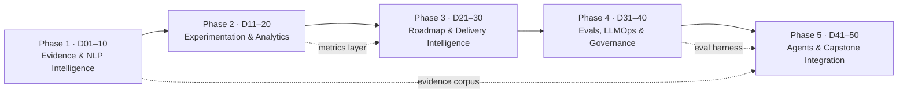

# ProdMind 50-Day Advanced Portfolio Roadmap

> **Status: PLANNED, NOT BUILT.** Nothing in this document exists in the repo yet. Each row is a proposed project. Its status changes to *built* only when its folder, tests, and UI land on `main`.

## Purpose
This plan extends ProdMind (`product-evidence-to-decision-suite`, modules 1–56) into a flagship collection covering **AI agents, product management, data analytics, experimentation, evals/LLMOps, and governance**. Every day has two linked advanced projects: an **AI Engineer (AI)** project and a **Product Manager (PM)** project. One project's output is the other project's input, so each day adds one connected workflow to the suite. Later days reuse the outputs of earlier days.

The plan replaces ProdMind's documented honest-status gaps with real implementations. The gaps are: deterministic NLP baselines, lexical-only retrieval, no significance testing, and no causal attribution.

## How to read it
- **Day | AI | PM | Link | Builds on**: each project is written as `name`: *input → output*.
- **Link**: `AI → PM` means the AI project's output is the PM project's input. `PM → AI` means the reverse.
- **Builds on**: existing modules by number/folder (e.g. `#2 sentiment_analyzer`), new areas, or earlier days (`D07`).
- **IDs**: `A01–A50` / `P01–P50` are placeholders. Merged projects occupy catalog numbers 57–89. These planned projects are not built. When one is built, its catalog number continues from 90 and its folder is an unprefixed snake_case directory such as `semantic_feedback_embedder/`, matching `feedback_collector/`. `experiment-data-quality-auditor/` keeps its existing hyphenated name.

## Per-project conventions
Every project follows ProdMind's existing module pattern:
1. **Folder**: `snake_case_name/` at the repository root, self-contained. The catalog number is stored in the catalog, not prefixed onto the folder. Existing modules follow this pattern (`feedback_collector/`, `sentiment_analyzer/`). `experiment-data-quality-auditor/` is the hyphenated exception.
2. **README** with a one-line *input → output*, a quick-start command, and a **How this connects** section (feeds from / feeds into / same-day partner / related).
3. **Tests**: unit and contract tests run by the root Node test runner (Python ML folders use pytest, called from the runner).
4. **Small web UI** in `public/`, served by a Cloudflare Worker. D1 is used for persistence when state is needed.
5. **Quick-start**: `npm run start -- <folder>` (or `python -m <pkg>` for ML folders). Every project ships fixture data so it runs in under 30 seconds.
6. **Catalog entry**: added to the root catalog file (id, track, phase, input, output, feeds_from, feeds_into). The catalog generates README tables and the connection diagram, and CI fails on broken links.
7. **Honest status**: each README states what is a model, what is a heuristic, and its known limits. The hub (#7 experiment-data-quality-auditor) keeps orchestrating the end-to-end workflow, and humans keep final decisions.

---

## Phase 1: Evidence & NLP Intelligence (Days 1–10)
*Theme: replace the deterministic baselines with trained, evaluated models and semantic retrieval over the feedback corpus.*

| Day | AI Engineer project | PM project | Link | Builds on |
|---|---|---|---|---|
| 01 | A01 `semantic_feedback_embedder`: raw feedback → vector index + dedup clusters | P01 `evidence_coverage_map`: clusters → map of customer segments × themes showing coverage gaps | AI → PM | #1 feedback_collector, #3 topic_modeler |
| 02 | A02 `aspect_sentiment_transformer`: feedback → aspect-level sentiment with calibrated confidence | P02 `pain_severity_scorecard`: aspect sentiment → severity-ranked pain points per persona | AI → PM | #2 sentiment_analyzer, D01 |
| 03 | A03 `neural_topic_discovery`: embeddings → BERTopic-style topics with drift over time | P03 `theme_lifecycle_tracker`: topic drift → emerging/fading theme alerts with owner | AI → PM | #3 topic_modeler, D01 |
| 04 | A04 `request_intent_extractor`: feedback → structured feature requests (job, outcome, constraint) via LLM + schema validation | P04 `jtbd_opportunity_canvas`: structured requests → Jobs-to-be-Done opportunity scores (importance × satisfaction) | AI → PM | #4 feature_request_detector |
| 05 | A05 `hybrid_evidence_retriever`: query → BM25 + vector reranked evidence with citations | P05 `research_question_bank`: open PM questions → retrieval queries + answer-quality ratings (fed back to tune A05) | PM → AI | #9 product_learning_memory, #11 evidence_integrity_monitor |
| 06 | A06 `churn_signal_classifier`: support + usage text → churn-risk scores with SHAP explanations | P06 `retention_save_playbook`: risk scores → segment-specific save plays and owner queue | AI → PM | #5 voice_of_customer_dashboard, #20 feature_adoption_analyzer |
| 07 | A07 `evidence_summarizer_with_citations`: theme cluster → grounded summary where every claim cites source IDs | P07 `customer_insight_brief`: summaries → one-page weekly insight brief for leadership | AI → PM | #5 voice_of_customer_dashboard, D03, D05 |
| 08 | A08 `pii_redaction_pipeline`: raw feedback → redacted text + audit log (NER + regex ensemble) | P08 `research_consent_ledger`: consent policy → per-source usage rules that A08 enforces | PM → AI | #11 evidence_integrity_monitor, #25 governance_obligation_monitor |
| 09 | A09 `competitor_mention_miner`: reviews/forums → competitor comparisons with stance | P09 `competitive_position_matrix`: comparisons → feature-parity and positioning matrix | AI → PM | #13 strategy_alignment_auditor |
| 10 | A10 `nlp_model_benchmark_suite`: labeled set → accuracy/F1/calibration report comparing baselines and A02–A04 | P10 `evidence_quality_sla`: benchmark → minimum quality gates evidence must pass before prioritization | AI → PM | #2–#4, D02–D04 |

## Phase 2: Experimentation & Data Analytics (Days 11–20)
*Theme: a governed metrics layer, real statistics, and causal inference, replacing ProdMind's no-significance and no-attribution limits.*

| Day | AI Engineer project | PM project | Link | Builds on |
|---|---|---|---|---|
| 11 | A11 `metrics_semantic_layer`: event tables → versioned metric definitions + SQL compiler | P11 `north_star_metric_tree`: strategy goals → metric tree that A11 compiles | PM → AI | #8 product_outcome_monitor, #13 |
| 12 | A12 `sequential_ab_test_engine`: experiment events → mSPRT/CUPED results with always-valid p-values | P12 `experiment_decision_memo`: results → ship/iterate/kill memo with guardrail checks | AI → PM | #7 experiment-data-quality-auditor, D11 |
| 13 | A13 `bayesian_experiment_analyzer`: variants → posterior lift + expected loss | P13 `risk_appetite_policy`: risk tolerance → expected-loss thresholds A13 uses for decisions | PM → AI | #7, #10 decision_calibration_engine |
| 14 | A14 `causal_impact_estimator`: launch + time series → synthetic-control/DiD lift with intervals | P14 `launch_attribution_review`: causal lift → benefits claim validated vs plan | AI → PM | #8, #16 benefits_realization_tracker |
| 15 | A15 `cohort_retention_modeler`: events → cohort curves + survival (Kaplan-Meier/Cox) model | P15 `retention_strategy_board`: curves → retention bets ranked by cohort impact | AI → PM | #20 feature_adoption_analyzer, D06 |
| 16 | A16 `metric_anomaly_detector`: metric streams → anomalies with seasonality-aware root-cause hints | P16 `incident_to_insight_triage`: anomalies → triaged product incidents with owner + postmortem | AI → PM | #8, D11 |
| 17 | A17 `kpi_forecaster`: metric history → probabilistic forecasts (Prophet/quantile GBM) | P17 `okr_target_setter`: forecast bands → realistic OKR targets with stretch levels | AI → PM | #16, D11 |
| 18 | A18 `uplift_targeting_model`: experiment data → heterogeneous treatment effects per segment | P18 `segment_rollout_planner`: uplift by segment → staged rollout plan | AI → PM | #19 release_readiness_controller, D12 |
| 19 | A19 `experiment_power_planner`: baseline metrics → sample size, MDE, and duration simulator | P19 `experiment_portfolio_calendar`: experiment backlog → traffic-allocated calendar that A19 validates | PM → AI | #12 research_portfolio_optimizer, #7 |
| 20 | A20 `analytics_copilot_sql`: natural-language question → validated SQL over the A11 semantic layer + chart | P20 `self_serve_insights_hub`: stakeholder questions → curated question library + adoption metrics | PM → AI | D11–D19, #5 |

## Phase 3: Roadmap & Delivery Intelligence (Days 21–30)
*Theme: ML-driven estimation, scheduling, and portfolio decisions that consume Phase 1 evidence and Phase 2 metrics.*

| Day | AI Engineer project | PM project | Link | Builds on |
|---|---|---|---|---|
| 21 | A21 `evidence_weighted_prioritizer`: P04/P02 outputs + metrics → ranked backlog with uncertainty | P21 `prioritization_debate_room`: ranked backlog → stakeholder trade-off log + final decision | AI → PM | #6 prioritization_engine, D02, D04 |
| 22 | A22 `effort_estimation_model`: ticket history → effort distributions (quantile regression) | P22 `estimate_confidence_review`: distributions → commit/forecast split for planning | AI → PM | #44–#47 roadmap_estimate_* and #48–#50 roadmap_recalibration_* |
| 23 | A23 `dependency_graph_miner`: repos + tickets → cross-team dependency graph | P23 `dependency_negotiation_plan`: graph → sequencing agreements + escalation path | AI → PM | #40 roadmap_delivery_scheduler |
| 24 | A24 `monte_carlo_delivery_simulator`: estimates + dependencies → P50/P85 delivery dates | P24 `release_commitment_charter`: date distributions → customer-facing commitments with buffers | AI → PM | #41 roadmap_delivery_monitor, D22, D23 |
| 25 | A25 `schedule_risk_early_warning`: sprint telemetry → slip-risk predictions per epic | P25 `roadmap_recovery_playbook`: slip risks → descope/re-sequence options | AI → PM | #42 roadmap_recovery_planner and #43 roadmap_recovery_verifier, #18 assumption_risk_register |
| 26 | A26 `portfolio_optimizer_milp`: bets + capacity → optimal portfolio (MILP) under constraints | P26 `quarterly_bet_review`: strategy constraints → constraints fed to A26, then approved portfolio | PM → AI | #12, #14 portfolio_rebalancing_simulator |
| 27 | A27 `estimate_recalibration_learner`: actual vs estimate → per-team bias correction | P27 `planning_retrospective_kit`: bias report → planning-policy changes | AI → PM | #51–#56 roadmap_recalibration_*, #32–#39 planning_policy_* |
| 28 | A28 `stress_scenario_generator`: portfolio → generated shock scenarios (capacity, demand, cost) | P28 `resilience_contingency_plan`: scenarios → pre-agreed contingency triggers | AI → PM | #15 portfolio_resilience_stress_tester |
| 29 | A29 `adoption_propensity_model`: usage → feature-adoption likelihood per account | P29 `go_to_market_launch_plan`: launch scope → enablement plan targeting high-propensity accounts | AI → PM | #20, #19 release_readiness_controller |
| 30 | A30 `sunset_impact_predictor`: feature usage + dependents → deprecation blast radius | P30 `feature_sunset_decision_pack`: blast radius → sunset plan, comms, and migration path | AI → PM | #21 product_lifecycle_planner, #22 sunset_migration_monitor, and #23 sunset_outcome_monitor |

## Phase 4: Evals, LLMOps & Governance (Days 31–40)
*Theme: make every AI component measurable, observable, and auditable, and tie it to ProdMind's governance modules.*

| Day | AI Engineer project | PM project | Link | Builds on |
|---|---|---|---|---|
| 31 | A31 `llm_eval_harness`: prompts + golden sets → scored runs (faithfulness, relevance, cost) | P31 `ai_quality_acceptance_criteria`: product requirements → eval rubrics + pass thresholds for A31 | PM → AI | D07, D10 |
| 32 | A32 `rag_groundedness_checker`: answer + sources → hallucination flags per claim | P32 `ai_trust_dashboard`: flags → trust KPIs per feature for leadership | AI → PM | D05, #11 evidence_integrity_monitor |
| 33 | A33 `prompt_regression_ci`: prompt diffs → CI pass/fail with eval deltas | P33 `ai_change_approval_flow`: eval deltas → approval/rollback decision record | AI → PM | #19 release_readiness_controller, #24 decision_provenance_pack |
| 34 | A34 `llm_cost_latency_observer`: traces → cost/latency per feature + routing suggestions | P34 `ai_unit_economics_model`: cost traces → per-feature margin and pricing guardrails | AI → PM | D11 metrics layer |
| 35 | A35 `red_team_attack_suite`: system prompts → adversarial jailbreak/injection test results | P35 `ai_risk_register`: findings → risk entries with owners and mitigations | AI → PM | #18 assumption_risk_register, #25 governance_obligation_monitor through #31 control_improvement_calibration |
| 36 | A36 `model_drift_monitor`: production inputs → data/concept drift alerts for A02–A06 | P36 `model_lifecycle_policy`: drift alerts → retrain/retire decisions under policy | AI → PM | D10, #21–#23 |
| 37 | A37 `fairness_bias_auditor`: model outputs × segments → disparity metrics | P37 `responsible_ai_review_board`: disparities → exception approvals or remediation | AI → PM | #26 governance_exception_register through #31 control_improvement_calibration |
| 38 | A38 `decision_lineage_graph`: runs + evidence → provenance graph from feedback to decision | P38 `audit_readiness_pack`: lineage graph → audit evidence binder | AI → PM | #24 decision_provenance_pack, #17 investment_assurance_review |
| 39 | A39 `policy_as_code_engine`: written policies → executable rules evaluated on every run | P39 `governance_obligation_mapper`: regulations (e.g. EU AI Act) → obligations encoded by A39 | PM → AI | #25 obligations, #32–#39 planning_policy_* |
| 40 | A40 `human_feedback_labeler`: low-confidence outputs → active-learning labeling queue | P40 `review_ops_capacity_plan`: queue volume → reviewer staffing + SLA | AI → PM | D36, #9 product_learning_memory |

## Phase 5: Agents & Capstone Integration (Days 41–50)
*Theme: tool-using multi-agent workflows that orchestrate Phases 1–4 under the eval harness (D31) and policy engine (D39), with humans approving final decisions.*

| Day | AI Engineer project | PM project | Link | Builds on |
|---|---|---|---|---|
| 41 | A41 `evidence_research_agent`: PM question → multi-step research report via A05 + A07 tools | P41 `discovery_sprint_planner`: research report → 2-week discovery plan with hypotheses | AI → PM | D05, D07, #9 |
| 42 | A42 `prd_drafting_agent`: opportunity + evidence → PRD draft with cited requirements | P42 `prd_review_scorecard`: PRD draft → completeness/risk score + reviewer notes | AI → PM | D04, D21 |
| 43 | A43 `experiment_designer_agent`: hypothesis → experiment spec (metrics, power, guardrails) | P43 `experiment_governance_gate`: spec → approve/revise decision before launch | AI → PM | D12, D19, #7 |
| 44 | A44 `metric_investigator_agent`: anomaly → root-cause analysis via A11/A16 tools | P44 `exec_metric_narrative`: RCA → weekly business review narrative | AI → PM | D16, D20 |
| 45 | A45 `roadmap_replanning_agent`: slip/shock signal → re-plan options via A24/A26 | P45 `stakeholder_tradeoff_comms`: chosen option → stakeholder update + decision log | AI → PM | D24–D26 |
| 46 | A46 `customer_simulation_agents`: personas from P01/P02 → simulated reactions to concepts | P46 `concept_test_synthesizer`: concepts → test plan; synthesis feeds go/no-go (simulation marked as non-evidence) | PM → AI | D01, D02 |
| 47 | A47 `governance_watchdog_agent`: run stream → policy violations + auto-filed exceptions | P47 `control_improvement_backlog`: exceptions → prioritized control fixes | AI → PM | D39, #26–#31 |
| 48 | A48 `agent_eval_arena`: agent traces → task success, tool-use accuracy, and cost leaderboard | P48 `agent_rollout_readiness`: leaderboard → which agents ship, to whom, under which guardrails | AI → PM | D31, D33, D41–D47 |
| 49 | A49 `orchestrator_supervisor`: goal → supervised multi-agent run over hub #7 with checkpoints | P49 `operating_cadence_designer`: team rituals → schedule/triggers the supervisor runs on | PM → AI | #7 hub, D41–D48 |
| 50 | A50 `flagship_capstone_pipeline`: raw feedback → end-to-end decision (evidence → priority → experiment → outcome → audit) | P50 `portfolio_case_study`: capstone run → public case study + catalog walkthrough for visitors | AI → PM | All phases, #1–#56 |

---

## Key cross-day dependencies
- **D01 embeddings** feed D03, D05, D07, D41, D46.
- **D10 benchmark** and **D31 eval harness** gate every model and agent shipped after them.
- **D11 metrics layer** is required by D12–D20, D34, and D44.
- **D24 simulator** and **D26 optimizer** are tools for the D45 agent.
- **D38 lineage** and **D39 policy engine** are required for D47 and D50.

## Coverage summary
| Area | Days |
|---|---|
| AI agents | 41–50 |
| NLP / retrieval | 1–10 |
| Data analytics (metrics layer, causal, forecasting, cohorts, anomalies, uplift) | 11–20, 44 |
| Experimentation | 12, 13, 18, 19, 43 |
| Roadmap / portfolio | 21–30, 45 |
| Evals / LLMOps | 10, 31–36, 48 |
| Governance / responsible AI | 8, 35, 37–39, 47 |
