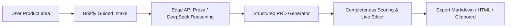

# 📝 Briefly — AI Product Requirements Document (PRD) Workspace

<!-- catalog:io:start -->
**Input → output:** a rough product concept → an editable PRD draft

**Quick start:** `cd briefly_prd_ai && pnpm install && pnpm test`

**Track:** PM · Advanced · built
<!-- catalog:io:end -->


<p align="center">
  <strong>Transform rough product concepts into comprehensive, decision-ready PRDs in seconds using DeepSeek & Next.js.</strong>
</p>

<p align="center">
  <a href="https://briefly.madanmohanlearning.workers.dev/"></a>
  <a href="#license"></a>
  <a href="https://nextjs.org"></a>
  <a href="https://react.dev"></a>
  <a href="https://deepseek.com"></a>
  <a href="https://workers.cloudflare.com"></a>
</p>

---

## What to review before using a draft

Briefly produces a draft, not validated customer research. Check assumptions, unknown metric baselines, acceptance criteria and launch dependencies before sharing it as an approved PRD.

The [generation route](app/api/generate/route.ts) requires a DeepSeek key and Redis configuration. Without them, generation or usage requests return a configuration error. The free-use counter is keyed to a salted hash of the client IP; it is not an authenticated per-user billing system. Configure `RATE_LIMIT_SALT` for your own deployment.

### Development checks

```bash
pnpm run lint
pnpm run test
```

The test script builds the app and runs the rendered-HTML tests. The current manifest uses Next.js 16.2.6, React 19.2.6 and Vinext; Node.js 22.13.0 or later is required. Model choice is configurable through `DEEPSEEK_MODEL`.

## 🌐 Live Deployment

**Briefly is live at:** https://briefly.madanmohanlearning.workers.dev/

---

## 📌 Overview

**Briefly** is an AI-powered product management workspace designed to eliminate the blank-page problem for Product Managers, Technical Program Managers, and Engineering Leads. By combining structured contextual intake with DeepSeek's advanced reasoning models, Briefly transforms loose product ideas into structured, actionable Product Requirements Documents (PRDs) complete with user personas, user stories, acceptance criteria, technical considerations, and success metrics.

---

## ✨ Key Features

- **🧠 Guided Contextual Intake:** Multi-step questionnaire capturing core problem statements, target personas, technical constraints, and business goals.
- **⚡ DeepSeek AI Synthesis:** Generates complete, structured PRD sections:
  - **Executive Summary & Problem Statement**
  - **Target User Personas & Pain Points**
  - **Functional Requirements & User Stories** (with testable acceptance criteria)
  - **Non-Functional Requirements** (Performance, Security, Compliance)
  - **Technical Architecture & Data Model Considerations**
  - **KPIs, Success Metrics & GTM Rollout Checklist**
- **✏️ Real-Time Document Completeness Scoring:** Live quality score evaluates the thoroughness of the PRD draft as you refine it.
- **💾 Local-First Drafts & Multi-Format Export:** Automatic local-storage draft saving with instant export to **Markdown (.md)**, **HTML**, and **Clipboard**.
- **🛡️ Privacy & Rate Limiting:** Server-side DeepSeek key protection with privacy-preserving SHA-256 hashed rate limiting via **Upstash Redis**.
- **🌐 Serverless & Edge Deployed:** Deployed as a full-stack Next.js application on **Cloudflare Workers** using the Vinext build configuration.

---

## 🏗️ Architecture



---

## 🚀 Quick Start

### Prerequisites
- **Node.js:** 22.13.0 or later
- **pnpm:** `npm install -g pnpm`
- **DeepSeek API Key**
- **Upstash Redis REST URL & Token** (for rate limiting)

### Installation

```bash
# Clone the repository
git clone https://github.com/MadanMohan0537/briefly-prd-ai.git
cd briefly-prd-ai

# Install dependencies
pnpm install

# Configure environment variables
cp .env.example .env.local
# Fill in DEEPSEEK_API_KEY, UPSTASH_REDIS_REST_URL, UPSTASH_REDIS_REST_TOKEN in .env.local

# Run development server
pnpm dev
```

Open [http://localhost:3000](http://localhost:3000) in your browser.

---

## 🛠️ Tech Stack

- **Framework:** Next.js (App Router), React
- **Language:** TypeScript
- **AI Model:** DeepSeek API (model configured with `DEEPSEEK_MODEL`)
- **State & Storage:** Local-first browser storage + Upstash Redis
- **Styling:** Vanilla CSS & PostCSS
- **Deployment:** Cloudflare Workers (Vinext)

---

<!-- catalog:connects:start -->
## How this connects

**Input → output:** a rough product concept → an editable PRD draft

**Upstream:** None in this catalog.

**Downstream:** [CaseFoundry](../requirements_traced_test_generator/README.md); [RiskCouncil](../launch_premortem_risk_register/README.md); [AI project manager assistant](../ai_project_manager_assistant/README.md)

**Related:** None in this catalog.

**Track:** PM · Advanced.

**Project 7:** Not imported by the Project 7 Worker. Links in this section are intended portfolio handoffs, not runtime imports.
<!-- catalog:connects:end -->
