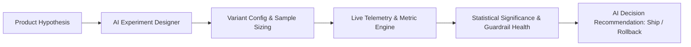

# 🧪 AI Product Experimentation Platform

<!-- catalog:io:start -->
**Input → output:** a hypothesis, results, and guardrails → a ship, hold, iterate, or rollback record

**Quick start:** `cd experiment_decision_workspace && npm install && npm test`

**Track:** PM · Connected workflow · built
<!-- catalog:io:end -->


<p align="center">
  <strong>A portfolio-grade product decision operating system for designing, monitoring, analyzing, and deciding A/B product experiments.</strong>
</p>

<p align="center">
  <a href="https://nextjs.org"></a>
  <a href="https://react.dev"></a>
  <a href="https://www.typescriptlang.org"></a>
  <a href="https://deepseek.com"></a>
  <a href="https://workers.cloudflare.com"></a>
</p>

---

## Demo data, model output and rollout boundaries

Start without provider keys for input-specific local planning outlines and local statistical analysis. [lib/ai.ts](lib/ai.ts) labels the no-key result as a local outline. With keys, the existing provider selection remains DeepSeek first, or Anthropic when only its key is configured.

Workspace counts are user-entered evidence, not live telemetry. Progressive rollout is recorded planning state and never changes a production feature flag. Review the working workflow section below for current functionality and limits.

### Development checks

```bash
npm run lint
npm test
```

The test script builds through the verified build wrapper and checks rendered HTML. Read [build verification](scripts/build-verified.sh) before adapting its environment conventions. The current stack uses Next.js 16.2.6, React 19.2.6 and Vinext; Node.js 22.13.0 or later is required.

## 📌 Overview

**AI Product Experimentation Platform** is a modern decision-support system built for Product Managers, Growth Leads, and Data Scientists. It replaces chaotic spreadsheet tracking with a unified workflow: from **hypothesis design and MDE power calculations** to **real-time telemetry monitoring, guardrail health tracking, and AI-synthesized rollout recommendations**.

---

## ✨ Key Features

- **📊 Portfolio Command Center:** Real-time visibility into active experiments, portfolio win rates, average time-to-learn, and active segment risks.
- **🔬 3-Step AI-Assisted Experiment Designer:**
  - Formulates testable hypotheses, target audience segments, and variant splits.
  - Automatically identifies **Primary KPIs**, **Secondary Metrics**, and **Guardrail Metrics** (e.g. latency, error rates, drop-offs).
  - Calculates Minimum Detectable Effect (MDE) and sample size requirements.
- **📈 Live Experiment Telemetry & Statistical Significance:**
  - Conversion trends, confidence interval visualization, and p-value statistical significance alerts.
  - Detects segment-specific anomalies (e.g. high Android checkout abandonment despite overall iOS conversion lift).
- **🤖 AI Decision Briefs & Rollout Control:**
  - Generates auditable **Ship / Iterate / Rollback** recommendations with business justification.
  - Supports progressive feature rollout controls from 1% to 100%.
- **🛡️ Provider-Agnostic AI Backend:** DeepSeek or Anthropic selected by configured keys, plus a fixed demo response when neither key is present.

---

## 🏗️ Architecture



---

## 🚀 Quick Start

### Prerequisites
- **Node.js:** 22.13.0 or later
- **AI Key:** (Optional) `DEEPSEEK_API_KEY` or `ANTHROPIC_API_KEY`

### Installation

```bash
# Clone the repository
git clone https://github.com/MadanMohan0537/ai-product-experimentation-platform.git
cd ai-product-experimentation-platform

# Install dependencies
npm install

# Configure environment variables
cp .env.example .env.local
# Add your DEEPSEEK_API_KEY or ANTHROPIC_API_KEY (optional: app runs in demo mode without keys)

# Start development server
npm run dev
```

Open [http://localhost:3000](http://localhost:3000) in your browser.

---

## 🛠️ Tech Stack

- **Framework:** Next.js 16 (App Router), React 19
- **Language:** TypeScript
- **Styling:** TailwindCSS, Modern CSS
- **AI Integrations:** DeepSeek API, Anthropic HTTP API
- **Runtime:** Cloudflare Workers (Vinext) / Vercel

---

## Working experiment workflow (2026-10 update)

The main product now creates and persists actual experiment drafts in the current browser, rather than showing fixed sample experiments or closing an unsaved design drawer. There is no artificial two-design trial gate. Search and the knowledge base operate on saved experiments and human review decisions.

1. Declare a hypothesis, audience, primary conversion metric, baseline and relative minimum useful effect.
2. Review the approximate per-arm sample requirement (50/50 assignment, fixed 5% two-sided alpha, 80% power).
3. Save the draft and record control/treatment visitors and conversions.
4. Add guardrails in native metric units with a preferred direction and allowed regression.
5. Inspect calculated rates, absolute/relative lift, a normal-approximation 95% difference interval, two-sided p-value, sample-ratio warning and the computed Hold / Ship / Iterate / Rollback recommendation.
6. Record your own review decision and a planned rollout percentage. Neither performs a release.
7. Export the workspace to JSON, import a validated backup, and search prior hypotheses and decisions.

The numerical engine lives in `lib/experiment-engine.ts`; it rejects impossible plans, invalid counts, sparse normal-approximation results and malformed imported drafts. A positive primary result cannot receive a Ship recommendation without entered guardrails. Source-count assumptions and sequential-peeking limits are exposed in each readout. No event ingestion, actual production feature flag, or universal causal validation is claimed.

Optional planning requests now reach the existing design endpoint. Without provider keys, a deterministic outline is built from the supplied goal and audience and labeled `local-outline`, rather than pretending a fixed example is AI-generated. With configured provider keys, provider output remains a proposal to review.

```bash
npm run test:engine
```

The engine suite covers sample-size boundaries, positive and negative results, guardrail overrides, sparse/underpowered samples, assignment mismatch, count validation, and draft-import validation. Workspace data stays in browser localStorage; export before changing devices or clearing browser data. Model-assisted planning sends the entered goal/audience to the configured provider; count analysis stays local.

<!-- catalog:connects:start -->
## How this connects

**Input → output:** a hypothesis, results, and guardrails → a ship, hold, iterate, or rollback record

**Upstream:** [Experimentation copilot](../ab_test_design_and_readout/README.md); [AB Advisor](../bayesian_ab_test_advisor/README.md)

**Downstream:** [Experiment & Learning Workspace](../experiment-data-quality-auditor/README.md)

**Related:** None in this catalog.

**Track:** PM · Connected workflow.

**Project 7:** Not imported by the Project 7 Worker. Links in this section are intended portfolio handoffs, not runtime imports.
<!-- catalog:connects:end -->
