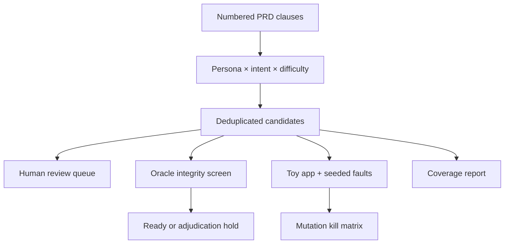

# CaseFoundry

<!-- catalog:io:start -->
**Input → output:** numbered PRD clauses → traceable cases and a mutation-detection report

**Quick start:** `cd requirements_traced_test_generator && PYTHONPATH=. python -m unittest discover -s tests -v`

**Track:** AI Engineer · Advanced · built
<!-- catalog:io:end -->


[](https://github.com/MadanMohan0537/requirements-traced-test-generator/actions/workflows/ci.yml)

CaseFoundry turns numbered PRD clauses into traceable happy-path, boundary, and hostile tests. It then runs those cases against seeded faults and reports which defects the suite can actually detect—not merely how many cases it generated.

> **Project Lab traceability:** catalog project 04, originally “Synthetic Test-Case Factory.” CaseFoundry is the product name; this metadata prevents the renamed idea from being built twice.

## The product problem

Handwritten golden sets skew toward happy paths and become stale as requirements change. Generating more text is not proof of useful coverage: ten paraphrases may all miss the same authorization bug. CaseFoundry keeps a source clause on every case, exposes thin requirements, routes every candidate through review, and measures mutation adequacy.

## Implemented scope

- Parse Markdown clauses written as `[R1] requirement text`.
- Generate deterministic cases across persona, intent, and difficulty dimensions.
- Produce explicit hostile and exact-boundary inputs for a sample source-backed assistant.
- Deduplicate near-identical cases with a transparent Jaccard rule.
- Persist a SQLite review queue with accept, edit, and reject states.
- Report per-requirement coverage and thin clauses.
- **P1 mutation adequacy:** run the suite against four deterministic faults, produce a case-to-mutation kill matrix, and compare the full grid with happy paths alone.
- **P2 oracle uncertainty queue:** keep evidence, expected behavior, oracle basis, and routing confidence separate; hold weak, manual, or contradictory oracles for explicit adjudication.
- Export portable JSON artifacts with no service credentials or paid dependencies.

Semantic PRD parsing, embedding deduplication, model-based generation, a browser review screen, Launch Gate integration, and PRD-diff regeneration are planned—not shipped.

## Quick start

```bash
python -m venv .venv
source .venv/bin/activate
python -m pip install -e .
casefoundry generate data/sample-prd.md \
  --output cases.json \
  --report coverage.json \
  --review-db reviews.db
```

Run the tests:

```bash
python -m unittest discover -s tests -v
```

No API key, model download, account, or network connection is required.

## Workflow



Every case contains `requirement_id`, `evidence`, structured `input`, `expected`, `persona`, `intent`, `difficulty`, and a generator version. Candidate cases are never automatically promoted to a trusted golden set.

Oracle screening compares cases with the same intent and canonical input. If
their expected behaviors disagree, every conflicting candidate is held even
when its routing confidence is high. Unknown domains use `manual-review` and
zero confidence rather than pretending the deterministic adapter understands
them. Confidence is a workflow hint, not a calibrated probability.

## Reproducible evidence

The sample PRD describes upload, grounding, refusal, and deletion policies. The toy app includes four independently selectable mutations:

| Mutation | Defect | Expected detecting case |
|---|---|---|
| `oversize_allowed` | Ignores the 1,000,000-byte limit | Exact limit + one byte |
| `unsafe_extension_allowed` | Accepts executable uploads | Hostile `.exe` upload |
| `role_check_removed` | Lets members delete documents | Member deletion attempt |
| `unsupported_answered` | Answers without source evidence | Unsupported question |

`coverage.json` records the mutation score, surviving faults, and the exact cases that killed each mutation. The tests also assert that a happy-path-only suite is inadequate, making the extension's incremental value explicit.

The frozen oracle experiment creates two expectations for the same
1,000,001-byte upload: `allow` and `deny`, each with confidence `0.95`.
CaseFoundry classifies both as `conflict` and persists their evidence and
counterpart IDs in the SQLite adjudication queue. The control suite from the
sample PRD routes all 16 domain-backed oracles to `ready`; novel-domain cases
route to `uncertain`.

## Input contract

```markdown
[R1] The system must accept plain-text uploads no larger than 1,000,000 bytes.
[R2] Every answer must be grounded in an uploaded source.
```

The initial executable templates recognize `R1`–`R5` from the bundled sample. Other requirement IDs receive traceable manual-review cases. This honest limitation avoids pretending a deterministic rules engine understands arbitrary product prose.

## Success measures

| Measure | MVP signal |
|---|---|
| Clause coverage | Cases per requirement and `thin` flag |
| Difficulty coverage | Happy, boundary, and hostile counts |
| Defect detection | Killed mutations / total mutations |
| Traceability | 100% of cases retain clause ID and evidence |
| Review readiness | All generated cases enter pending review |
| Oracle integrity | Conflicts and unsupported expectations are held for adjudication |

Reviewer acceptance rate and defects found per 100 cases require real reviewers and incident-derived defects; the MVP does not invent those results.

## Limitations

- The parser requires explicit requirement IDs and one clause per line; it is not a general natural-language PRD parser.
- Executable expectations are domain templates for the bundled toy app. New domains need reviewed adapters.
- Token-set deduplication misses semantic paraphrases and can overvalue superficial vocabulary changes.
- Seeded mutations are controlled proxies. They may not represent production incidents, so an incident-derived mutation set remains necessary.
- A 100% score means only that this suite killed these four mutations—not that the application is correct.
- SQLite supports a small local review workflow, not concurrent enterprise moderation.
- The review queue has no authentication, assignment, audit signatures, or web UI.
- Oracle confidence values are deterministic routing metadata, not statistically calibrated probabilities.
- Conflict matching requires identical canonical structured inputs and intent; it does not yet discover semantic or cross-clause contradictions.
- Adjudication records a decision and reason but does not yet require two reviewers or preserve an append-only signature trail.

## Safety and review

Generated expected behavior can be confidently wrong. Preserve requirement evidence, review cases before promotion, and never use synthetic tests as the sole release gate for safety-critical, regulated, legal, or clinical decisions. Hostile fixtures should contain synthetic data only.

## Roadmap

See [docs/BACKLOG.md](docs/BACKLOG.md) for prioritized extensions with user problem, behavior, dependencies, success test, and tradeoffs. See [docs/ARCHITECTURE.md](docs/ARCHITECTURE.md) for design decisions and production-hardening boundaries.

<!-- catalog:connects:start -->
## How this connects

**Input → output:** numbered PRD clauses → traceable cases and a mutation-detection report

**Upstream:** [Briefly PRD workspace](../briefly_prd_ai/README.md)

**Downstream:** [Issue to draft PR agent](../issue_to_draft_pr_agent/README.md)

**Related:** None in this catalog.

**Track:** AI Engineer · Advanced.

**Project 7:** Not imported by the Project 7 Worker. Links in this section are intended portfolio handoffs, not runtime imports.
<!-- catalog:connects:end -->
